# Patria: Feature Requirements

Every feature of the Patria app, with its flow, business rules, edge cases and acceptance criteria. Feature IDs match the PRD (docs/PRD.md). Use the acceptance criteria as the definition of done for each feature.

**Priority key:** P0 = required for MVP launch. P1 = required for the phase listed. P2 = planned, flexible.

**Build order:** CIR05, CIR01, CIR02 (identity, keys, access) first; then MEM01, MEM02, MEM05, CIR03 (capture); then AI01; then MEM03, MEM04, LEG01 to LEG03, GOV01, GOV02. Phase 2 and 3 features follow.

## System overview

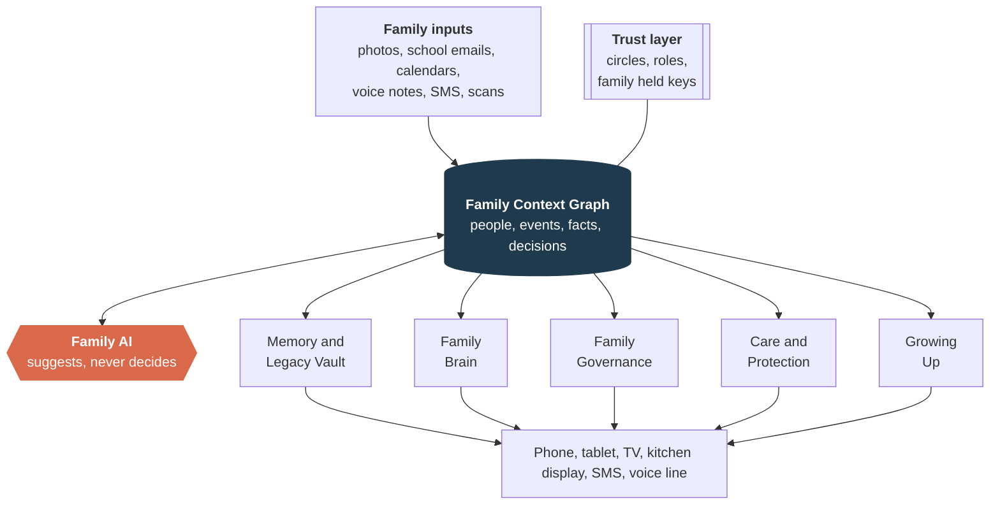

## Feature index

| ID | Feature | Module | Priority | Phase | Depends on |
|---|---|---|---|---|---|
| CIR05 | Onboarding and Family Space Setup | CIR | P0 | Phase 1 | None (entry point) |
| CIR01 | Circles | CIR | P0 | Phase 1 | CIR05 |
| CIR02 | Roles and Permissions | CIR | P0 | Phase 1 | CIR01 |
| CIR03 | No App Participation (SMS and Voice Line) | CIR | P0 | Phase 1 | CIR01, CIR02 |
| CIR04 | Every Family Shape (Multiple Households) | CIR | P1 | Phase 2 | CIR01, CIR02 |
| MEM01 | Shared Family Library | MEM | P0 | Phase 1 | CIR05, CIR01 |
| MEM02 | Smart Cleanup | MEM | P0 | Phase 1 | MEM01 |
| MEM03 | Stories, Not Folders | MEM | P0 | Phase 1 | MEM01, MEM02 |
| MEM04 | Resurfacing | MEM | P0 | Phase 1 | MEM03 |
| MEM05 | On Device Face Recognition | MEM | P0 | Phase 1 | MEM01 |
| MEM06 | Scan and Save Keepsakes | MEM | P1 | Phase 2 | MEM01 |
| MEM07 | Family Archive Search | MEM | P1 | Phase 2 | MEM01, MEM05, AI01 |
| MEM08 | Keepsakes: Books, Calendars and Albums | MEM | P2 | Phase 3 | MEM03, MEM04 |
| LEG01 | Decision Ledger | LEG | P0 | Phase 1 | CIR02, family keys |
| LEG02 | Letters to the Future (Time Locked Release) | LEG | P0 | Phase 1 | LEG01, GROW04 for long term release |
| LEG03 | Oral History Interviews | LEG | P0 | Phase 1 | CIR03 |
| LEG04 | Living Family Tree | LEG | P1 | Phase 2 | MEM05, LEG03 |
| LEG05 | Traditions, Recipes and Culture | LEG | P1 | Phase 2 | MEM06, LEG03 |
| LEG06 | Memorial Space | LEG | P2 | Phase 3 | LEG04, MEM04 |
| GOV01 | Family Constitution Builder | GOV | P0 | Phase 1 | CIR05 |
| GOV02 | Weekly Family Sync | GOV | P0 | Phase 1 | GOV01 (optional), BRN03 calendar import |
| GOV03 | Kids Mode for the Sync | GOV | P1 | Phase 2 | GOV02 |
| GOV04 | Decision Framework | GOV | P1 | Phase 3 | GOV01, LEG01 |
| GOV05 | State of the Family (Quarterly Review) | GOV | P1 | Phase 3 | GOV01, GOV02 |
| BRN01 | Family Knowledge Base | BRN | P1 | Phase 2 | CIR01, AI01 |
| BRN02 | Auto Intake | BRN | P1 | Phase 2 | Email and calendar connectors, BRN03 |
| BRN03 | Unified Weekly View | BRN | P1 | Phase 2 (calendar import from Phase 1) | Calendar connectors |
| BRN04 | Conflict Spotting | BRN | P1 | Phase 2 | BRN03 |
| BRN05 | Tasks with Ownership | BRN | P1 | Phase 2 | GOV02 |
| BRN06 | Fair Share | BRN | P1 | Phase 2 | BRN05, BRN02 |
| BRN07 | Meals, Groceries and Home Maintenance | BRN | P2 | Phase 2 | BRN01, BRN03 |
| BRN08 | Handover Guide for Babysitters and Sitters | BRN | P2 | Phase 2 | BRN01, CIR02 |
| CARE01 | Emergency Card | CARE | P1 | Phase 2 | BRN01 |
| CARE02 | Health Records | CARE | P2 | Phase 3 | Vault tier |
| CARE03 | Medication Reminders with Escalation | CARE | P2 | Phase 3 | CARE04 |
| CARE04 | Elder Care Hub | CARE | P2 | Phase 3 | CIR01 custom circles |
| CARE05 | Early Signals | CARE | P2 | Phase 3 | CARE04, consent of the person |
| CARE06 | Scam Protection | CARE | P2 | Phase 3 | CIR03 |
| CARE07 | Document Vault and Renewals | CARE | P1 | Phase 3 | Vault tier, GROW04 |
| CARE08 | Shared Goals and Kids Money | CARE | P2 | Phase 3 | BRN05 |
| GROW01 | Age Bands | GROW | P1 | Phase 3 | CIR02 |
| GROW02 | Teen Private Space and Agreements | GROW | P1 | Phase 3 | GROW01 |
| GROW03 | Capability Transfer | GROW | P2 | Phase 3 | GROW01, GROW02 |
| GROW04 | Generational Custody Handover | GROW | P2 | Phase 3 | Vault tier, LEG02, CARE07 |
| GROW05 | Life Transition Kits | GROW | P2 | Phase 3 | BRN05, CIR01 |
| AI01 | Memory Answers | AI | P0 | Phase 1 | MEM01, CIR01 |
| AI02 | Plans That Fit | AI | P1 | Phase 2 | BRN03, BRN01 |
| AI03 | Creative Help | AI | P1 | Phase 2 | AI01 |
| AI04 | Gentle Observations and Nudges | AI | P1 | Phase 2 | BRN03, CIR03 |
| AI05 | Voice and Language for Everyone | AI | P1 | Phase 2 | AI01, CIR03 |

## Circles, Roles and Access (CIR)

*Trust layer (foundation).* These features decide who belongs to the family space, who sees what, and how people without the app take part. They are built first because every other feature depends on them. In Patria, privacy is not a settings page; it is enforced by the encryption keys themselves.

### CIR05 Onboarding and Family Space Setup

**Priority:** P0 (new in FRD) | **Phase:** Phase 1 | **Users:** Founding parent, invited members | **Depends on:** None (entry point)

**What it is.** The first ten minutes in Patria. A parent creates the family space, Patria creates the family key on that phone, recovery helpers are set up later before the vault is first used, then the parent connects a photo library and invites the rest of the family. The goal is a moment of joy (a first story or resurfaced memory) before any setup work is asked of anyone else.

**Why it matters.** Family apps fail when they feel like homework on day one. Patria earns trust by giving value first and asking for effort later.

**User stories**

* As a busy parent, I want to see something meaningful from my own photos within minutes, so that I know Patria is worth inviting my family into.
* As a parent, I want to add Grandma by phone number only, so that she can take part without installing an app.
* As a teen, I want to see exactly what my parents can see before I accept the invite, so that I can trust the space.

**How it works**

1. Parent downloads Patria, signs up with email or Apple or Google sign in, and names the family space (for example "The Rivera Family").
2. Patria creates the family key on the founding parent’s phone; recovery helpers are set up later, before the vault is first used. Helpers are adult family members who hold the key (contacts outside the family come later).
3. Parent is invited to connect their photo library. Analysis starts on the device in the background.
4. Within minutes the home view shows a first Story and a "one year ago" memory.
5. Parent invites members by link, QR code or phone number, choosing a role (section 11 of the PRD) and default circle for each.
6. Members with the app accept and see a plain language summary of what others can see about them. Members without the app receive a welcome SMS.
7. Patria suggests two first steps: a first oral history question for an elder and a Family Constitution session this weekend.

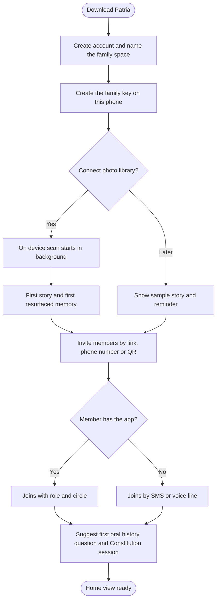

**Business rules**

* A family space must have at least one Family admin. If the last admin leaves, ownership passes to the co admin or the named successor.
* Children under 13 can only be added by an admin; they never create accounts on their own (COPPA).
* Recovery helpers (adult family members who hold the key) are mandatory before the Legacy Vault can be used, not before Home.
* Invitations expire after 14 days and can be revoked at any time.
* A person can belong to more than one family space (for example two co parenting households or their own family and their parents’ family).

**Edge cases**

| Scenario | What Patria does |
|---|---|
| Parent skips photo connection | Show a sample Story using stock images and a reminder card the next day. |
| Invitee has a different language set on their phone | Invite and welcome SMS are sent in that language when supported. |
| Two parents both create a family space | Patria detects matching invite contacts and offers to merge the two spaces. |
| Phone number belongs to an existing Patria user | The invite lands in their app instead of by SMS. |

**Acceptance criteria (definition of done)**

* [ ] A new parent reaches the home view with at least one Story or memory in under 10 minutes on a library of 1,000 or more photos.
* [ ] An elder added by phone number receives a welcome SMS within 1 minute and can reply to post.
* [ ] Every invited member sees a "what others can see about you" summary before accepting.
* [ ] Family keys are created on the device; the server never receives an unencrypted family key.
* [ ] No phone gets the family key without a person approving it.
* [ ] Recovery cannot finish before the server wait, after cancel or expiry, or with fewer than two helpers.
* [ ] No table stores the printed code, anything derived from it, a recovery private key, or a family-wide recovery secret.
* [ ] After a key holder leaves they cannot open any new key version.

**Data captured:** Family space name, members, roles, circles, recovery contacts, invite status, key metadata (never the key itself).

**Success measure:** 80% of new families see a first memory within 24 hours; 60% invite at least one more member in the first session.

### CIR01 Circles

**Priority:** P0 | **Phase:** Phase 1 | **Users:** All members | **Depends on:** CIR05

**What it is.** Circles are the audiences inside a family space. Every item in Patria (photo, story, note, task, document) belongs to one circle, which decides who can see it. Default circles are Household, Extended Family and Close Friends, plus Only Me. Families can create custom circles such as "Mom’s side" or "Care team for Dad".

**Why it matters.** Families share differently with different people. Without circles, people either overshare or stop sharing.

**User stories**

* As a parent, I want daily updates to stay in the household while milestones go to the wider family, so that relatives feel included without noise.
* As a sibling caring for Dad, I want a care circle that only the siblings see, so that medical details stay private.

**How it works**

1. When a member creates or uploads anything, the circle picker shows the default circle for that type of item.
2. Each item shows a small circle badge so everyone always knows who can see it.
3. Members can move an item to a smaller circle at any time; moving to a larger circle asks for confirmation.
4. Admins can create custom circles, add or remove people, and set defaults per item type.

**Business rules**

* Default circles: Household (people living together), Extended Family, Close Friends, Only Me. Default membership is D30 in DECISIONS.md: Household is Family admin, Co admin, Teen and Elder; Extended Family is those people plus Extended relatives; Close Friends starts empty; Only Me is the person.
* Items inherit the strictest circle of any content they contain (a Story with a private photo stays private).
* Children’s content defaults to Household only until an admin changes it.
* Removing a person from a circle removes their access immediately, including cached copies on their devices at the next sync.

**Edge cases**

| Scenario | What Patria does |
|---|---|
| A photo includes a person who has asked not to be shared widely | Patria suggests a smaller circle and explains why. |
| A member leaves the family space | Their own uploads stay with them; shared copies stay in the family space unless they request removal. |

**Acceptance criteria (definition of done)**

* [ ] Every item in the app displays the circle that can see it.
* [ ] A member outside a circle cannot see, search or receive notifications about items in that circle (tested through the API, not only the UI).
* [ ] Circle membership changes take effect in under 60 seconds across all devices.

**Data captured:** Circle name, members, default item types, owner.

**Success measure:** At least 2 circles in active use per family by month 2.

### CIR02 Roles and Permissions

**Priority:** P0 | **Phase:** Phase 1 | **Users:** Admins (set), all members (experience) | **Depends on:** CIR01

**What it is.** Roles define what each person can do. Roles are Family admin, Co admin, Teen (13 to 17), Child (4 to 12), Elder, Extended relative, Caregiver and Successor. Permissions are checked on the server and, for vault content, enforced by encryption keys.

**Why it matters.** A five year old, a teenager, a grandparent and a babysitter need very different experiences and protections.

**User stories**

* As a parent, I want my 7 year old to see a visual chore board but not our documents, so that she has a safe and simple view.
* As a teen, I want my private space to stay private unless we agreed otherwise, so that I can trust the app.

**How it works**

1. Admin assigns a role when inviting a member; age based roles are suggested from date of birth.
2. Every request (view, edit, share, delete) passes the access check shown in the diagram.
3. Vault and sealed items additionally require the member to hold a decryption key.
4. Role changes are logged and shown to the affected person.

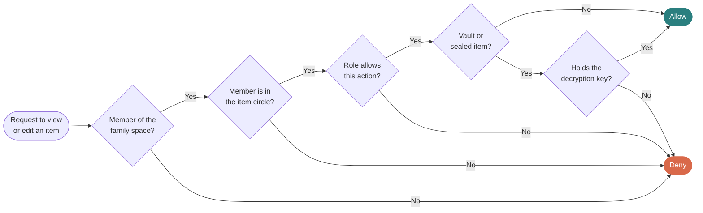

**Business rules**

* Only Family admins can change roles, delete the family space, or manage custody settings.
* Teens cannot be moved into a role with less privacy without a notification to the teen.
* Caregiver access is always time limited (default 24 hours, maximum 30 days).
* Successors have no access until a custody trigger completes (see GROW04).

**Edge cases**

| Scenario | What Patria does |
|---|---|
| Child turns 13 | Patria prompts parents and the teen to agree a Teen role and boundaries (GROW02). |
| Admin tries to read a teen private space | Blocked unless the agreed boundary allows it; the attempt is not hidden from the teen. |

**Acceptance criteria (definition of done)**

* [ ] Permission matrix from the PRD is enforced for every role in automated tests.
* [ ] A role change is visible to the affected member within 1 minute.
* [ ] No API endpoint returns vault content to a member without the matching key.

**Data captured:** Role per member, date of birth (optional), role history log.

**Success measure:** Zero permission related security incidents; fewer than 2% of support tickets about access confusion.

### CIR03 No App Participation (SMS and Voice Line)

**Priority:** P0 | **Phase:** Phase 1 | **Users:** Elders, relatives abroad, low tech members | **Depends on:** CIR01, CIR02

**What it is.** Members who will never install an app can still take part. Each family gets a Patria number. Elders text, send photos, or leave voicemails to that number, and Patria posts them into the right circle. They also receive a simple weekly digest and oral history prompts by SMS or a phone call.

**Why it matters.** Grandparents hold the family’s oldest stories and are the least likely to install apps. Without this, the legacy promise fails.

**User stories**

* As Grandma Rosa, I want to leave a voice message about the old family house, so that my grandchildren can hear it in my voice.
* As a parent, I want Grandma to receive photos of the kids by SMS, so that she feels close without learning an app.

**How it works**

1. Admin links an elder’s phone number to their member profile.
2. The elder saves the Patria number as "Family" on their phone.
3. Incoming texts, photos and voicemails are matched to the member and posted to their default circle.
4. Voicemails are transcribed and translated where needed, but the original audio is always kept.
5. Every Sunday the elder receives a short digest: a photo or two and a line about each grandchild.

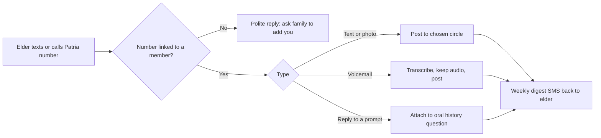

**Business rules**

* Only numbers linked to members can post. Unknown numbers get a polite reply and nothing is posted.
* WhatsApp support is added where the platform allows business messaging at reasonable cost.
* Digest frequency is capped at once a week unless the elder asks for more.
* Standard SMS and call costs are covered by the Family plan; free plan has a monthly allowance.

**Edge cases**

| Scenario | What Patria does |
|---|---|
| Elder replies STOP | All messages stop and the admin is told; the elder can restart by texting START. |
| Voicemail is in Yoruba | Transcribed in Yoruba with an English translation shown underneath when available. |
| Elder sends a sensitive message by mistake | Admin can hide it; the elder can text DELETE within 10 minutes. |

**Acceptance criteria (definition of done)**

* [ ] An elder can post a photo and a voicemail by SMS and call without an app, and both appear in the family space within 2 minutes.
* [ ] Original audio is retrievable for every transcribed voicemail.
* [ ] Unknown numbers can never post content.

**Data captured:** Linked phone numbers, message logs, audio files, transcripts, translations.

**Success measure:** 35% of families have a grandparent participating by month 12.

### CIR04 Every Family Shape (Multiple Households)

**Priority:** P1 | **Phase:** Phase 2 | **Users:** Co parents, blended families, chosen family | **Depends on:** CIR01, CIR02

**What it is.** Support for families that do not fit one roof: two co parenting households, step families, adult children with their own households, and chosen family. A child can belong to two households with separate calendars, while sharing only what both households agree.

**Why it matters.** A large share of children live across two homes. Tools that assume one household exclude them.

**User stories**

* As a co parent, I want my child’s school events visible in both homes without sharing my private calendar, so that handoffs go smoothly.
* As a step parent, I want to be part of the family space with a role that fits, so that I feel included but not intrusive.

**How it works**

1. An admin creates a linked household and invites the other household’s admin.
2. Both admins choose which items flow between households (child’s school events, medical info, handoff schedule).
3. Shared children appear in both spaces; each household keeps its own private items.
4. Handoff days show on both calendars with a checklist (school bag, medicine, homework).

**Business rules**

* Nothing crosses between linked households unless both admins have allowed that type of item.
* Either household can unlink; shared history stays with each household for its own copies.
* Court ordered arrangements can be stored in the document vault; Patria never enforces legal orders.

**Edge cases**

| Scenario | What Patria does |
|---|---|
| Two households disagree on sharing medical records | Item type stays unshared until both agree; a neutral notice explains why. |
| Child has photos in both spaces | The child sees both libraries merged in their own view as they grow (GROW03). |

**Acceptance criteria (definition of done)**

* [ ] A child can belong to two households with two separate calendars and one combined child view.
* [ ] An item type is shared across households only after both admins enable it.

**Data captured:** Linked households, sharing agreements per item type, handoff schedule.

**Success measure:** Retention of co parenting families matches or beats single household families.

## Memory Stream (MEM)

*Pillar 1: Memory and Legacy Vault.* The Memory Stream is Patria’s front door. It gathers photos and videos from every consenting phone into one family library, cleans it up, turns it into stories and brings memories back at the right moments. It delivers joy on day one and feeds the Family Context Graph with who the family is, where they go and what matters to them.

### MEM01 Shared Family Library

**Priority:** P0 | **Phase:** Phase 1 | **Users:** All members with the app | **Depends on:** CIR05, CIR01

**What it is.** Photos and videos from each consenting member’s phone flow automatically into one family library. Each member chooses whether to share their whole library, only photos with family faces, or selected albums.

**Why it matters.** Every family already has thousands of photos spread across phones. Bringing them together is the fastest way to show value and build context.

**User stories**

* As a parent, I want photos my spouse takes of the kids to appear in our family library automatically, so that I stop asking "can you send me that picture?"
* As a teen, I want to share only photos that include family members, so that my personal photos stay mine.

**How it works**

1. Member grants photo library permission and picks a sharing mode: All, Family faces only, or Selected albums.
2. On device analysis tags faces, quality and duplicates before anything is uploaded.
3. Items that pass the sharing mode are encrypted and uploaded in the background on WiFi by default.
4. The library shows everything by date, with filters by person, place, event and member who took it.

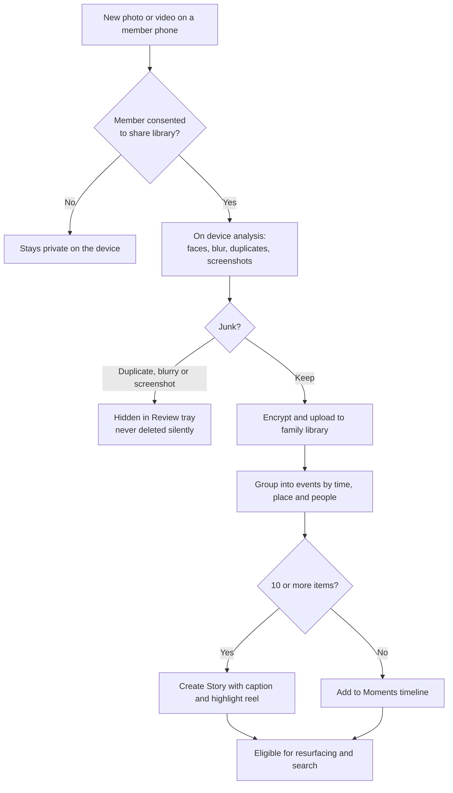

**Business rules**

* Nothing uploads without explicit consent from the phone’s owner. Parents cannot turn on sharing for a teen’s phone.
* Original quality is kept on paid plans; free plan stores high quality copies up to the storage limit.
* Upload uses WiFi only by default; cellular is opt in.
* Members can remove anything they uploaded at any time.

**Edge cases**

| Scenario | What Patria does |
|---|---|
| Phone storage full or low battery | Pause analysis and upload; resume when charging. |
| Same photo shared by two members | Stored once, credited to both. |
| Very large library (50,000 or more items) | Process newest first, show progress, finish over several days. |

**Acceptance criteria (definition of done)**

* [x] Slice 1: a member picks one or more photos (that pick is consent), chooses a circle (Household by default), optionally captions them, and they appear in the family library for people in that circle.
* [x] Slice 1: photos are resized and re-encoded as JPEG on the phone (location stripped; date taken kept), stored in a private bucket, and shown newest first with a circle badge, uploader name and date.
* [x] Slice 1: the uploader can move their photo (confirm if more people will see it) or delete it (files then row). Others cannot.
* [x] Slice 1: a person outside the circle, a caregiver, a successor, a removed member, and another family cannot read the record or mint a viewing link.

Slice 1 is done (real iPhone tests 14–16 after D30 on hosted). Test 17 step 2 (removed member’s screen after refresh) is still pending by hand.

* [x] Slice 2: pick up to 30 photos or short videos at once; each uploads on its own; a failure does not stop the others, and the person is told which item was skipped and why.
* [x] Slice 2: short videos (≤60s, ≤50 MB after Medium export) play in the library; location must be gone or the video is refused. Add photos names that limit before the picker opens. Over-limit videos are refused as soon as the picker returns. The library tile shows a JPEG frame (or a clean placeholder) with play and length overlaid.
* [x] Slice 2: a member can connect their photo library (All new photos or Selected albums) in under 3 minutes, pick a circle, and start from today or the last 30 days.
* [x] New photos appear in the family library within 1 hour when the phone is on WiFi (slice 2: while Patria is open, phone test 19; camera and background upload later).
* [ ] "Family faces only" mode uploads no photo without a recognized family member.

Slice 2 is done (real iPhone tests 18 and 19 on Expo Go, hosted). Tests 20–23 stay as written (album isolation, cellular when WiFi is unavailable, deleted sync photo). Camera, Limited access, Family faces only, and upload while Patria is closed stay later.

**Left for later slices:** upload while Patria is closed, Family faces only (MEM05), video from library sync, Android library sync, smart cleanup (MEM02), Stories (MEM03), the whole back catalogue, Private Memories.

**Data captured:** Media files (Standard tier), capture time, uploader, circle, source hash (keyed), connection settings without album names. Location is not stored. Face tags and quality scores come later.

**Success measure:** Average of 2 or more contributing phones per active family.

### Private Memories (planned)

**Priority:** P1 | **Phase:** later | **Users:** Opt-in per circle | **Depends on:** MEM01, CIR05 keys

**What it is.** An opt-in layer that encrypts chosen memories on the device with keys the family holds, comparable to iCloud Advanced Data Protection. Standard-tier library items stay as they are unless a circle turns this on.

**Why it matters.** Some families will want vault-grade protection for a subset of photos. This must not be the default, and it must not reuse a hastily copied crypto path.

**How it will work (not built).** Design follows family keys: device-held keys, wraps for people in that circle, rotation when someone leaves. The security reviewer reviews the design before implementation.

**Acceptance criteria:** none until that review.

### MEM02 Smart Cleanup

**Priority:** P0 | **Phase:** Phase 1 | **Users:** All members | **Depends on:** MEM01

**What it is.** Patria hides exact and near duplicates, blurry shots and screenshots, and picks the best photo from a burst. Hidden items go to a Review tray; nothing is deleted without a person confirming.

**Why it matters.** A family library full of clutter is a chore. Cleanup makes it feel curated without anyone doing the work.

**User stories**

* As a parent, I want the 14 near identical shots of the birthday cake reduced to the best one, so that our library is a joy to scroll.

**How it works**

1. On device models score each item for sharpness, faces, eyes open, and duplication.
2. Bursts and near duplicates are grouped; the best is shown, the rest are tucked behind it.
3. Screenshots, receipts and documents are moved to the Review tray (and offered to the document vault if relevant).
4. Members can review the tray weekly and confirm deletion or restore items.

**Business rules**

* Patria never deletes originals from a member’s phone.
* Items in Review are restored automatically if a member opens them twice.
* Screenshots that look like documents are never shown in Stories.

**Edge cases**

| Scenario | What Patria does |
|---|---|
| A blurry photo is the only photo of a late relative | Never hidden if the person is marked as in memoriam. |
| Intentional duplicate (edited version) | Keep both when edits are detected. |

**Acceptance criteria (definition of done)**

* [ ] At least 90% of exact duplicates hidden on a test library.
* [ ] Zero deletions happen without a confirm action.
* [ ] Best of burst selection agrees with human pick in at least 70% of test sets.

**Data captured:** Quality scores, duplicate groups, review status.

**Success measure:** Fewer than 5% of hidden items restored by users (signals good precision).

### MEM03 Stories, Not Folders

**Priority:** P0 | **Phase:** Phase 1 | **Users:** All members | **Depends on:** MEM01, MEM02

**What it is.** Patria groups moments into named Stories such as "Grandma’s 70th" or "First week of school", each with a short caption, a cover photo and a highlight reel set to music.

**Why it matters.** Families remember events, not folders. Stories make the library feel like a family history rather than a camera roll.

**User stories**

* As a grandparent, I want to open "Lily’s first day of school" as one story with a short video, so that I can feel I was there.
* As a parent, I want to rename a story and add a note, so that it is told in our words.

**How it works**

1. Items are clustered by time, place and people into events.
2. Events with 10 or more good items become a Story; smaller ones join the Moments timeline.
3. The AI suggests a title and one line caption using calendar events and known places ("San Antonio Christmas 2026").
4. A highlight reel of 30 to 60 seconds is generated with licensed music.
5. Members can edit the title, caption, cover and items, and add voice notes.

**Business rules**

* Story circle defaults to the strictest circle of its items.
* AI titles never include sensitive places (hospitals, clinics) unless a member writes them.
* Highlight reels exclude photos of people marked as "do not feature".

**Edge cases**

| Scenario | What Patria does |
|---|---|
| Trip spans two time zones | Group by local time at the place where photos were taken. |
| Funeral or hospital event detected | Create a quiet Story without music or a reel, and never resurface automatically. |

**Acceptance criteria (definition of done)**

* [ ] Stories are generated automatically for events with 10 or more photos.
* [ ] Members can edit any AI generated title and caption.
* [ ] Sensitive events never get automatic reels or music.

**Data captured:** Story title, caption, items, cover, reel, edits history.

**Success measure:** 50% of active families open at least one Story per week.

### MEM04 Resurfacing

**Priority:** P0 | **Phase:** Phase 1 | **Users:** All members | **Depends on:** MEM03

**What it is.** Patria brings memories back at meaningful moments: "One year ago today", "Five summers at the lake", "Lily growing up". Memories appear on the home view, the kitchen display and, for elders, by SMS.

**Why it matters.** Resurfacing is the emotional hook that brings the family back each week without nagging.

**User stories**

* As a parent, I want to see last year’s first day of school photo on this year’s first day, so that I can share it with the kids.

**How it works**

1. A daily job collects candidate memories for each family.
2. Candidates are filtered against sensitive tags, hidden people, memorial rules and circle visibility.
3. Candidates are ranked by quality, people coverage and family reactions.
4. The best memory is delivered within quiet hours limits, to the people in its circle.

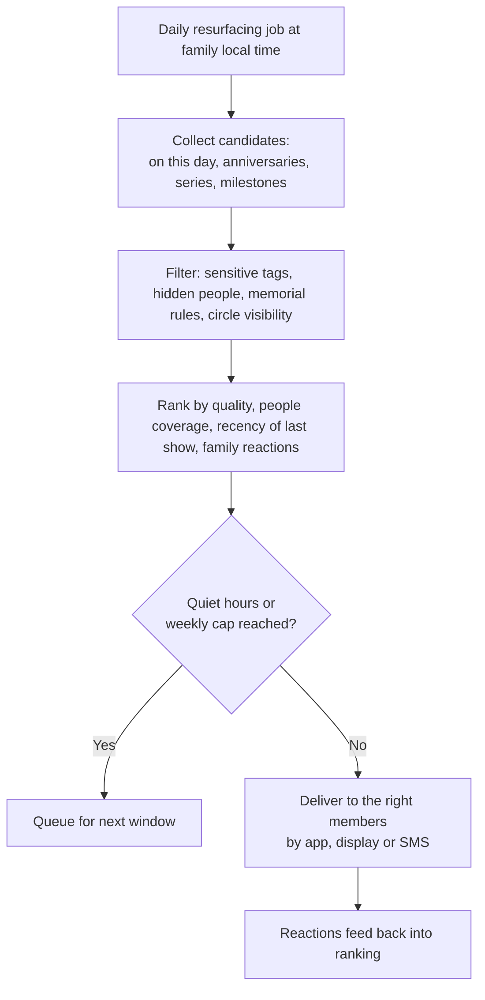

**Business rules**

* No more than one resurfaced notification per member per day, and none during quiet hours (default 9pm to 8am).
* Members can mute a person, place or date range from resurfacing (for example after a divorce or loss).
* Memorial content resurfaces only on dates the family chooses.

**Edge cases**

| Scenario | What Patria does |
|---|---|
| Memory includes an ex partner | Excluded once a member hides that person from resurfacing. |
| Anniversary of a death | Not resurfaced unless the family set it as a remembrance date. |

**Acceptance criteria (definition of done)**

* [ ] At least one resurfaced memory within 24 hours of onboarding.
* [ ] Muted people and dates never appear in resurfacing (verified by automated tests).
* [ ] Delivery respects quiet hours in the member’s local time zone.

**Data captured:** Resurfacing log, reactions, mutes.

**Success measure:** Reaction rate on resurfaced memories above 25%.

### MEM05 On Device Face Recognition

**Priority:** P0 | **Phase:** Phase 1 | **Users:** All members (background) | **Depends on:** MEM01

**What it is.** Faces are detected and grouped on each member’s phone. Members name a face once ("This is Grandpa") and Patria links that person across the library. Face data never leaves the family space in readable form.

**Why it matters.** Knowing who is in each photo powers Stories, search, resurfacing and the Family Tree, while privacy is part of the promise.

**User stories**

* As a parent, I want to tag Grandpa once and see every photo of him, so that I can build a tribute for his birthday.

**How it works**

1. Phone detects faces and creates numeric face templates locally.
2. Templates are encrypted with the family key and synced so all members’ devices share the same people list.
3. Members confirm or correct suggested names; corrections improve matching.
4. People are linked to member profiles or Family Tree entries.

**Business rules**

* Face templates are never used to train shared models and never leave the family space.
* Biometric consent is collected where required by law (for example Illinois BIPA, GDPR).
* Any person can ask to be removed from face grouping; their face is then ignored.

**Edge cases**

| Scenario | What Patria does |
|---|---|
| Twins or siblings who look alike | Lower confidence matches are queued for human confirmation. |
| Children’s faces change fast | Templates are refreshed by age band to keep matches accurate. |

**Acceptance criteria (definition of done)**

* [ ] Independent review confirms face templates are not uploaded in readable form.
* [ ] Naming a person once links at least 85% of their clear photos.
* [ ] Removing a person from face grouping takes effect on all devices within 1 hour.

**Data captured:** Encrypted face templates, person labels, confirmations.

**Success measure:** Average of 6 or more named people per family by month 1.

### MEM06 Scan and Save Keepsakes

**Priority:** P1 | **Phase:** Phase 2 | **Users:** Parents, elders, children | **Depends on:** MEM01

**What it is.** Scan drawings, handwritten letters, report cards, recipes and old printed photos with the phone camera. Patria crops, enhances, reads the text and files each item to the right person and era.

**Why it matters.** Some of the most precious family items are on paper and fade or get lost.

**User stories**

* As a parent, I want to scan my 7 year old’s drawings each month, so that we keep them without storing boxes of paper.
* As an adult child, I want to scan Mom’s handwritten recipes, so that they are kept in her handwriting forever.

**How it works**

1. Member taps Scan and points the camera; Patria auto detects edges and captures.
2. Image is cropped, straightened and enhanced; handwriting and print are read.
3. Patria suggests the type (drawing, letter, recipe, report, old photo), person and date.
4. Member confirms; the item joins the library and, for recipes, the Traditions space (LEG05).

**Business rules**

* Report cards and health papers default to Household circle.
* Recipes keep the original image alongside typed text.

**Edge cases**

| Scenario | What Patria does |
|---|---|
| Old photo with unknown date | AI suggests a decade; family can correct. |
| Multiple photos on one album page | Detect and split into separate items. |

**Acceptance criteria (definition of done)**

* [ ] Scans are cropped, enhanced and searchable by their text.
* [ ] Album page detection splits at least 90% of multi photo pages correctly.

**Data captured:** Scan images, extracted text, type, linked person, estimated date.

**Success measure:** 30% of Family plan households scan at least one keepsake a month.

### MEM07 Family Archive Search

**Priority:** P1 | **Phase:** Phase 2 | **Users:** All members | **Depends on:** MEM01, MEM05, AI01

**What it is.** Natural language search across photos, stories, scans, voice notes and notes: "Every birthday Dad celebrated with us", "Photos of Grandpa’s farm", "Lily’s drawings from 2026".

**Why it matters.** An archive is only valuable if you can find things in it.

**User stories**

* As a parent, I want to find all photos of the kids with their cousins, so that I can make a gift for my sister.

**How it works**

1. Member types or speaks a query.
2. Patria interprets people, places, dates, events and objects in the query.
3. Results are limited to items the member can see (CIR01) and grouped by Story.
4. Results can be saved as a smart album that updates itself.

**Business rules**

* Search never reveals the existence of items outside the member’s circles.
* Search index is encrypted per family.

**Edge cases**

| Scenario | What Patria does |
|---|---|
| Query mentions a person not yet named | Offer to name faces that match. |
| No results | Suggest a broader query and nearby dates. |

**Acceptance criteria (definition of done)**

* [ ] Top 10 results judged relevant 80% of the time in user testing.
* [ ] Results return in under 1 second for libraries up to 50,000 items.

**Data captured:** Encrypted search index, saved albums.

**Success measure:** Weekly search use by 25% of active members.

### MEM08 Keepsakes: Books, Calendars and Albums

**Priority:** P2 | **Phase:** Phase 3 | **Users:** Parents, gift givers | **Depends on:** MEM03, MEM04

**What it is.** Patria assembles yearly photo books, wall calendars, and printed albums automatically, ready to review and order. It also produces a "Family Year in Review" video each December.

**Why it matters.** Physical keepsakes create emotional moments and revenue, and they spread Patria to relatives as gifts.

**User stories**

* As a parent, I want a finished family photo book draft each December, so that I can order gifts for grandparents in one tap.

**How it works**

1. Patria drafts the book from the year’s top Stories and milestones.
2. Member reviews pages, swaps photos and edits captions.
3. Checkout through a print partner; shipping to multiple addresses supported.

**Business rules**

* Only items in circles the buyer can see are used.
* Print partner receives only the final print file, never the library.

**Edge cases**

| Scenario | What Patria does |
|---|---|
| Family has few photos this year | Offer a smaller format or a calendar instead. |

**Acceptance criteria (definition of done)**

* [ ] A complete draft book is generated in one tap.
* [ ] Order can ship to at least 3 addresses in one checkout.

**Data captured:** Book drafts, orders (via partner).

**Success measure:** 10% of paid families order a keepsake in Q4.

## Legacy Vault (LEG)

*Pillar 1: Memory and Legacy Vault.* The Legacy Vault holds what a family wants to pass on on purpose: the reasoning behind big decisions, letters to the future, the voices of elders, the family tree, traditions and memorials. It is the most sensitive and most defensible part of Patria, protected by zero knowledge encryption and tied to the Generational Custody Handover (GROW04).

### LEG01 Decision Ledger

**Priority:** P0 | **Phase:** Phase 1 | **Users:** Parents, elders, adults | **Depends on:** CIR02, family keys

**What it is.** A place for heads of the household to record major turning points (career changes, moves, investments, faith choices, helping relatives) with the "why" in their own words by text, audio or video. Patria structures each entry into decision, options considered, values, risks and who decided, and lets the author share now or seal it for later.

**Why it matters.** Children inherit their parents’ outcomes but rarely their reasoning. The Decision Ledger turns lived experience into a guide for the next generation.

**User stories**

* As a father, I want to record why we moved from Chicago to Houston, so that my children understand the sacrifice when they face their own big moves.
* As a mother, I want the app to help structure my rambling voice note, so that it reads clearly in 20 years.

**How it works**

1. Author taps New decision and records voice, video or text (2 minutes is enough).
2. AI transcribes and drafts a structured summary: the decision, options, what mattered most, risks, who decided, and the outcome so far.
3. Author edits and approves the summary; the original recording is always kept.
4. Author chooses: share now with a circle, keep private, or seal for future release (LEG02 rules).
5. Optional: add a follow up later ("Five years on, here is how it turned out").

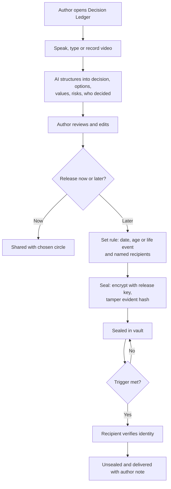

**Business rules**

* Ledger entries are zero knowledge encrypted; Patria staff cannot read them.
* The author is the only person who can edit or delete an entry while alive and in control.
* Entries from the Decision Framework (GOV04) can be promoted to the Ledger with one tap.
* Follow ups are linked to the original entry and released together.

**Edge cases**

| Scenario | What Patria does |
|---|---|
| Author dies before releasing an entry | Release rules continue to run through custody (GROW04). |
| Entry mentions a living relative negatively | AI suggests a gentle review before sealing; author decides. |
| Very long video (over 30 minutes) | Accepted on Legacy plan; free plan limit 5 minutes per entry. |

**Slice 1 (D33).** Text decisions only. Each entry is encrypted on the phone with a per-entry key wrapped to the family key. Voice, video, AI structure and sealing wait. Writers are Family admin, Co admin and Elder who hold the key and have recovery set up; teens read; only the author edits or deletes; follow-ups are child rows.

**Acceptance criteria (definition of done)**

* [x] An adult key holder with recovery can type a decision, save it, and another key holder can read it (phone tests 26–28).
* [x] The server stores only ciphertext, nonces and wrapped CEKs; family key rotation re-wraps every CEK in the same call (pgTAP).

Slice 1 is done (real iPhone tests 26–30 on Expo Go, hosted).

**Slice 2 (D34).** Voice notes (recorded in Patria, up to 5 minutes, no AI) and Only me entries (personal key with recovery). Writers stay Family admin, Co admin and Elder with recovery. Follow-ups keep the parent’s visibility. Hosted phone tests 31–35 wait.

* [ ] An entry can be created by voice in under 2 minutes (phone tests 31–35).
* [ ] Original recordings are kept and playable alongside the structured summary.
* [ ] An external security review confirms the server cannot decrypt Ledger content.

**Data captured:** Recording, transcript, structured fields, release rule, follow ups.

**Success measure:** 20% of active families record at least one decision in their first 3 months.

### LEG02 Letters to the Future (Time Locked Release)

**Priority:** P0 | **Phase:** Phase 1 | **Users:** Parents, grandparents, any adult | **Depends on:** LEG01, GROW04 for long term release

**What it is.** Messages written or recorded now and released later to named recipients: on a date ("10 years from today"), at an age ("Lily at 18"), or on a life event ("Sofia’s wedding day", "first child"). Sealed content cannot be read by anyone, including Patria, before release.

**Why it matters.** A letter from a parent on a wedding day, or a grandparent’s voice at a graduation, is priceless. Patria makes it reliable across decades.

**User stories**

* As a mother, I want to record a message for my daughter’s 18th birthday, so that she hears it even if I am not there.
* As a grandfather, I want to leave a letter for my first great grandchild, so that they know where they come from.

**How it works**

1. Author writes or records the letter and picks recipients.
2. Author picks a trigger: date, recipient age, or life event (confirmed by a named family member).
3. Patria encrypts the letter with a release key held in split form by people the family chooses, never by Patria alone, following the CIR05 family key rules; a tamper evident hash proves it has not changed.
4. The letter moves through the states shown below until it is released or withdrawn.
5. On release, the recipient verifies identity and opens the letter with a short note from Patria about when and why it was written.

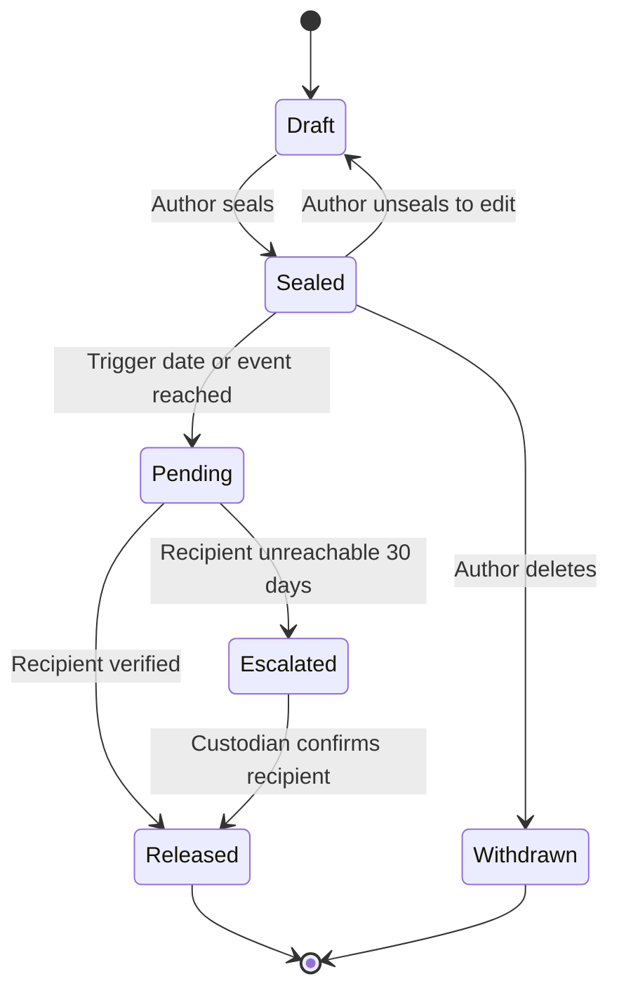

**Business rules**

* Life event triggers need a confirmer (for example, a parent confirms "Sofia got married").
* A recipient who is a minor at release gets the letter through their guardian unless the author chose otherwise.
* Authors can see the list of their sealed letters and edit or withdraw while in control.
* Letters survive company failure through the continuity escrow described in the PRD.

**Edge cases**

| Scenario | What Patria does |
|---|---|
| Recipient unreachable for 30 days after trigger | Escalate to custodian or successor to help deliver. |
| Life event never happens | Author can set a fallback date (for example "or at 35"). |
| Recipient no longer in the family space | Delivered by secure email link after identity check. |

**Acceptance criteria (definition of done)**

* [ ] Sealed content is unreadable by anyone, including Patria, before release (verified by security review).
* [ ] Date and age triggers release within 1 hour of the trigger time.
* [ ] Tamper evident hash is shown on release and matches the sealed version.

**Data captured:** Encrypted letter, recipients, trigger, confirmer, state history.

**Success measure:** 15% of families seal at least one letter in year 1.

### LEG03 Oral History Interviews

**Priority:** P0 | **Phase:** Phase 1 | **Users:** Elders (answer), all members (ask, listen) | **Depends on:** CIR03

**What it is.** Patria periodically "interviews" elders with warm prompts ("What was your first job?", "How did you meet Grandpa?", "What was your village like?"). Elders answer by app, SMS, voicemail or a scheduled phone call. Answers are kept in the original voice, transcribed, translated if needed, and linked to the Family Tree.

**Why it matters.** When an elder passes, their stories, accents and wisdom usually go with them. This captures them gently over time.

**User stories**

* As a grandchild, I want to hear Grandma tell how she came to London, so that I know my history in her voice.
* As a parent, I want to add my own question for Grandpa, so that the kids’ curiosity reaches him.

**How it works**

1. Family chooses which elders to interview and how often (default weekly).
2. Patria picks a question from a curated library of 300 or more prompts, or a family member writes one.
3. Prompt is delivered by the elder’s preferred channel (app, SMS, call at a set time).
4. Answer is recorded, transcribed, translated and posted to the Extended Family circle.
5. Family members react and can ask follow up questions, which join the queue.

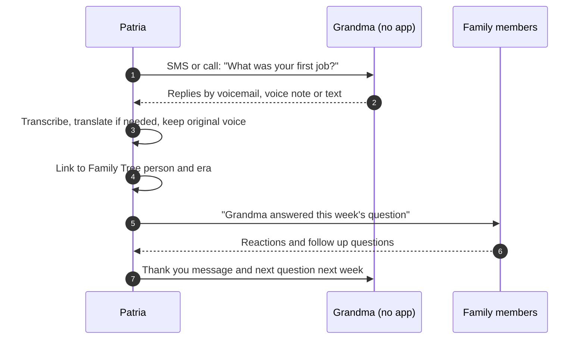

**Business rules**

* Prompts avoid traumatic topics unless the family adds them deliberately.
* Elders can skip any question by replying SKIP.
* Original audio is always kept; transcripts are editable by the elder or an admin.
* Answers are grouped by life chapter (childhood, work, marriage, migration, faith, advice).

**Edge cases**

| Scenario | What Patria does |
|---|---|
| Elder has dementia | Family can switch to "memory prompts" with photos and simpler questions. |
| Answer is very long | Patria creates chapters with timestamps. |
| Elder passes away | Their collection becomes part of their memorial space (LEG06). |

**Acceptance criteria (definition of done)**

* [ ] An elder can answer by voicemail with no app and the answer appears in the archive.
* [ ] Transcripts are produced for English, Yoruba, Igbo, Hausa, Spanish and French by the end of Phase 2.
* [ ] Family members can add their own questions to an elder’s queue.

**Data captured:** Prompt, audio, transcript, translation, life chapter, linked people.

**Success measure:** 30% of families with an elder record at least 5 answers in 3 months.

### LEG04 Living Family Tree

**Priority:** P1 | **Phase:** Phase 2 | **Users:** All members | **Depends on:** MEM05, LEG03

**What it is.** An interactive, media rich family tree. Each relative links to their photos, stories, voice recordings, recipes and documents. Migrations and key places are shown on a map.

**Why it matters.** The tree turns scattered memories into a family story that children can explore.

**User stories**

* As a child, I want to tap Great Grandpa and hear his voice, so that he feels real to me.
* As a parent, I want to import our tree from a genealogy site, so that we do not start from scratch.

**How it works**

1. Members add relatives manually or import a GEDCOM file.
2. Named faces (MEM05) and oral history answers (LEG03) are linked automatically.
3. Each person has a profile page with a life timeline.
4. A map view shows birthplaces, homes and migration routes.

**Business rules**

* Living people outside the family space show minimal details (name only) unless they join.
* Deceased relatives can be marked in memoriam (LEG06).

**Edge cases**

| Scenario | What Patria does |
|---|---|
| Two relatives with the same name | Disambiguate by birth year and parents. |
| Conflicting dates from two sources | Show both with source labels until resolved. |

**Acceptance criteria (definition of done)**

* [ ] GEDCOM import supported; adding a relative takes under 1 minute.
* [ ] Each person profile shows linked media automatically.

**Data captured:** People, relationships, dates, places, sources.

**Success measure:** Average of 15 or more people in the tree by month 6.

### LEG05 Traditions, Recipes and Culture

**Priority:** P1 | **Phase:** Phase 2 | **Users:** All members | **Depends on:** MEM06, LEG03

**What it is.** A home for what makes the family who they are: holiday rituals, special recipes, sayings, songs, prayers and the family’s native language. Patria reminds the family before each tradition and helps children learn the language from grandparents’ recordings.

**Why it matters.** Traditions fade quietly unless someone keeps them alive, especially for families living far from home.

**User stories**

* As a parent abroad, I want my kids to learn Yoruba greetings from Grandma’s recordings, so that they can talk to her.
* As a family, we want a reminder two weeks before our Christmas tradition, so that we can prepare.

**How it works**

1. Members add a tradition, recipe, saying or song with photos, audio and steps.
2. Each tradition can have a date and reminder rule.
3. Language cards are created from elder recordings for children to practice.

**Business rules**

* Recipes keep the original handwritten scan when available.
* Tradition reminders follow quiet rules and go to the Household circle by default.

**Edge cases**

| Scenario | What Patria does |
|---|---|
| Tradition date moves each year (for example Easter or Eid) | Support movable feast calendars. |

**Acceptance criteria (definition of done)**

* [ ] Tradition reminders are sent before the relevant date.
* [ ] Language cards play the original voice recording.

**Data captured:** Tradition entries, recipes, audio, reminder rules.

**Success measure:** 25% of families add at least 3 traditions in year 1.

### LEG06 Memorial Space

**Priority:** P2 | **Phase:** Phase 3 | **Users:** Family members after a loss | **Depends on:** LEG04, MEM04

**What it is.** When a loved one passes, their profile can become a memorial: photos, stories, voice recordings and messages from family, with gentle rules for what resurfaces and when.

**Why it matters.** Grief needs care. A memorial keeps memories together and stops painful surprises.

**User stories**

* As a grieving daughter, I want Dad’s voice recordings in one place, so that I can listen when I am ready.

**How it works**

1. An admin converts a profile to memorial and chooses visibility.
2. Family members can add memories and messages.
3. Resurfacing switches to "remembrance only" for that person.
4. Remembrance dates are set by the family.

**Business rules**

* Only admins can create a memorial; any member can contribute.
* Automatic resurfacing of the person stops until the family sets remembrance dates.

**Edge cases**

| Scenario | What Patria does |
|---|---|
| Person was a member with their own vault | Custody rules apply first (GROW04). |

**Acceptance criteria (definition of done)**

* [ ] Family can convert a profile to a memorial with chosen visibility.
* [ ] No automatic resurfacing of the person after conversion unless a remembrance date is set.

**Data captured:** Memorial settings, contributions, remembrance dates.

**Success measure:** Qualitative: family feedback on sensitivity.

## Family Governance (GOV)

*Pillar 3: Family Governance.* Family Governance brings light structure to how the family agrees on who it is, runs its week, makes decisions and checks how it is doing. It borrows ideas from how good organizations run (values, meetings, decision rights, reviews) without making home life feel like a company. Every feature here must take minutes, not hours.

### GOV01 Family Constitution Builder

**Priority:** P0 | **Phase:** Phase 1 | **Users:** Parents, teens, any adult in the household | **Depends on:** CIR05

**What it is.** A guided, roughly 30 minute session that helps the family write a one page Family Constitution: who we are, what we value, how we treat one another, how we make decisions, and our non negotiables. The AI turns the family’s answers into a draft in their own words.

**Why it matters.** Values that are written down can be taught, revisited and passed on. The Constitution anchors the Family Sync, the Decision Framework and the State of the Family.

**User stories**

* As parents, we want a simple guided session to agree our family values, so that we stop assuming and start teaching them.
* As a teen, I want to add my own words to the Constitution, so that it feels like ours, not just my parents’ rules.

**How it works**

1. An admin starts a session on a phone or the TV.
2. Patria walks through five prompts, collecting answers by voice or text from each participant.
3. The AI drafts one page with headings, using the family’s phrases (for example "We speak truthfully", "We solve problems rather than blame people").
4. Every adult reviews; changes loop back to the draft until all adults agree.
5. Version 1 is published to the Household circle, shown on the home view, and a yearly review reminder is set.

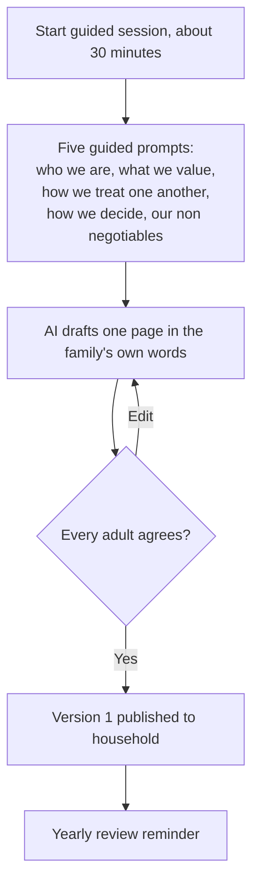

**Business rules**

* All adults in the household must approve before a version is published.
* Teens can contribute and comment; younger children can add a picture or a sentence.
* Every version is kept; the current one is marked.
* Templates are offered (faith based, secular, multigenerational) but never forced.

**Edge cases**

| Scenario | What Patria does |
|---|---|
| Parents disagree on a value | Patria keeps it as "still discussing" and adds it to the next Family Sync. |
| Single parent household | One adult approval is enough. |

**Acceptance criteria (definition of done)**

* [ ] A family can produce a one page Constitution in a single session of about 30 minutes.
* [ ] Constitution can be exported as a printable page and a kitchen display card.
* [ ] Version history is kept and viewable.

**Data captured:** Answers, drafts, approved versions, approvers, review date.

**Success measure:** 40% of active families publish a Constitution within 60 days.

### GOV02 Weekly Family Sync

**Priority:** P0 | **Phase:** Phase 1 | **Users:** Household members | **Depends on:** GOV01 (optional), BRN03 calendar import

**What it is.** A 20 to 30 minute weekly family meeting run by Patria on a phone, tablet or TV. It follows four steps: Look Back, Look Ahead, Align and Connect. The agenda builds itself from the calendar, tasks, memories and open decisions.

**Why it matters.** A short weekly rhythm prevents surprises, spreads the load and gives every person a voice. It is also the habit that keeps families returning.

**User stories**

* As a parent, I want an agenda ready every Sunday, so that the meeting takes 20 minutes, not an hour of planning.
* As a child, I want to say what was hard this week, so that my family knows how I feel.

**How it works**

1. Saturday: Patria builds the agenda from next week’s events, conflicts, overdue tasks, a happy memory, and open decisions.
2. Sunday: a reminder goes to the household with the planned time.
3. Look Back: what went well, what was difficult, did anyone feel overlooked.
4. Look Ahead: events, conflicts, who needs help, decisions to make.
5. Align: one priority for the week and owners for key tasks.
6. Connect: who needs time, care or encouragement.
7. Notes are saved to family history; owners and tasks are pushed into the week.

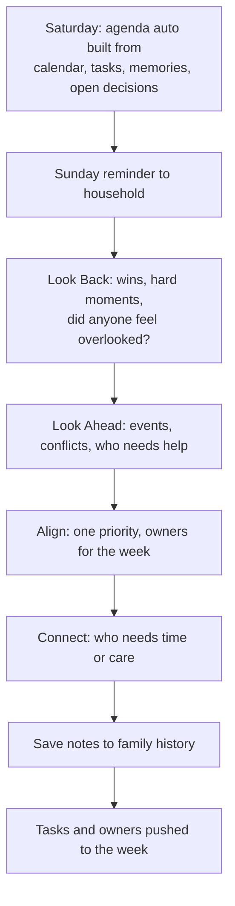

**Business rules**

* Any household member can add an item to the next agenda during the week.
* The Sync can be held without the app; a printable agenda is offered.
* Missed Syncs never trigger guilt messages; Patria simply offers the next one.
* Notes are Household circle only by default.

**Edge cases**

| Scenario | What Patria does |
|---|---|
| One parent traveling | Remote join from phone with voice; agenda shared ahead. |
| Family has young children only | Simplified mode (GOV03) runs automatically. |

**Acceptance criteria (definition of done)**

* [ ] Agenda is ready every Sunday morning in the family’s time zone.
* [ ] Tasks assigned during the Sync appear in owners’ weeks immediately.
* [ ] Notes saved to family history and searchable.

**Data captured:** Agenda items, notes, priority, owners, attendance.

**Success measure:** 30% of active families complete a Sync at least 3 times a month.

**Slice 1 (D35) — in progress.** Manual weekly Sync on Standard-tier storage (not the family key). Admin sets weekday, time, time zone and circle (Household or Extended Family). Anyone in that circle with a login adds Win / Discuss / Decide / Plan items during the week; admins may attribute to a child profile. One phone runs the meeting: Wins → Look ahead → Decide → Gratitude, then one priority and tasks. Undiscussed items carry over when the next circle is the same or narrower. Missed times show no guilt—only Hold it now or the next date. No Fair Share, no auto agenda from calendars, no push. Home Today card and This week tasks ship in the same slice after Sync works. Phone tests 36–41.

### GOV03 Kids Mode for the Sync

**Priority:** P1 | **Phase:** Phase 2 | **Users:** Children 4 to 12 with a parent | **Depends on:** GOV02

**What it is.** A playful version of the Family Sync with pictures, emoji style feelings and simple questions: "What was your best moment?", "What was hard?", "Who helped you?", "What will you help with this week?"

**Why it matters.** Children learn that their voice matters and that everyone contributes to the family.

**User stories**

* As a 5 year old, I want to pick a picture of how I feel, so that I can join the family meeting.

**How it works**

1. Kids Mode starts automatically when children under 8 are part of the Sync, or by choice.
2. Each child picks a feeling card and answers one or two picture prompts.
3. Children choose a helper task from a picture list.
4. A sticker or small celebration closes the session.

**Business rules**

* No scores, rankings or comparisons between siblings.
* Answers are saved to the child’s timeline for parents and, later, the child.

**Edge cases**

| Scenario | What Patria does |
|---|---|
| Child picks a sad feeling repeatedly | Patria gently suggests one on one time to parents (never labels the child). |

**Acceptance criteria (definition of done)**

* [ ] Usable by a 5 year old with a parent in under 10 minutes.
* [ ] No comparison between children is ever shown.

**Data captured:** Feeling cards, answers, chosen helper tasks.

**Success measure:** Parent satisfaction with Kids Mode above 4 out of 5.

### GOV04 Decision Framework

**Priority:** P1 | **Phase:** Phase 3 | **Users:** Parents, teens, affected relatives | **Depends on:** GOV01, LEG01

**What it is.** A guided way to make big family decisions: should we move, which school, can we afford this, should we help a relative financially, how much screen time. It walks through what is being decided, who is affected, options, costs, risks, fit with the family’s values, who has final responsibility, and when to review.

**Why it matters.** It prevents decisions being made by whoever is loudest, and it leaves a record of reasoning that can later join the Decision Ledger.

**User stories**

* As parents, we want to compare two schools against our values and budget, so that we decide calmly and together.
* As a teen, I want to give my view on the move, so that I feel heard even if my parents decide.

**How it works**

1. A member creates a decision with a title, deadline and who is affected.
2. Options are added with costs; Patria can help research facts on request.
3. Each option is checked against the Constitution values and listed risks.
4. Affected members add their views privately or openly.
5. The person with final responsibility records the decision and a review date.
6. Optionally promote the decision to the Decision Ledger for legacy.

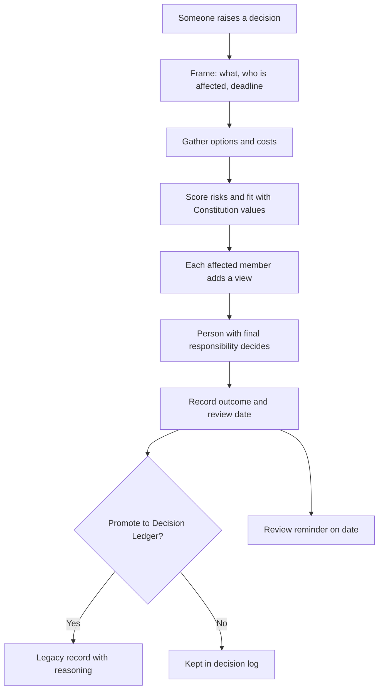

**Business rules**

* Final responsibility must be named before a decision can be closed.
* Views marked private are visible only to the person with final responsibility.
* Review reminders fire on the set date and appear in that week’s Sync.

**Edge cases**

| Scenario | What Patria does |
|---|---|
| Deadline passes without a decision | Reminder to the responsible person and added to the next Sync. |
| Decision involves extended family money | Can be shared with a custom circle (for example siblings). |

**Acceptance criteria (definition of done)**

* [ ] Decisions can be promoted to the Decision Ledger in one tap.
* [ ] Review reminders fire on the set date.
* [ ] Every closed decision shows who decided and why.

**Data captured:** Decision, options, costs, risks, values fit, views, outcome, review date.

**Success measure:** 20% of families log a decision through the framework each quarter.

### GOV05 State of the Family (Quarterly Review)

**Priority:** P1 | **Phase:** Phase 3 | **Users:** Adults and teens in the household | **Depends on:** GOV01, GOV02

**What it is.** Once a quarter, adults and teens privately rate nine areas green, yellow or red: relationships, emotional wellbeing, faith and values, finances, home, children’s development, personal growth, fun, and safety. Patria combines the ratings into one family view and helps the family agree ONE focus for the next quarter.

**Why it matters.** It keeps families from trying to fix everything at once and surfaces quiet concerns before they grow.

**User stories**

* As a parent, I want to see where we all feel the family is struggling, so that we focus on what matters most.

**How it works**

1. Quarter end reminder goes to adults and teens.
2. Each person rates the nine areas privately and can add a comment.
3. Patria shows a combined view (mostly green, mixed, or concern) without individual scores.
4. Family discusses yellows and reds in a longer Sync.
5. One focus is agreed and shown on the home view and in weekly Syncs.

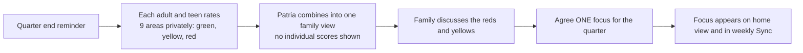

**Business rules**

* Individual ratings are never shown to others; only the combined view.
* Exactly one focus per quarter.
* Areas can be renamed to fit the family (for example "Faith" to "Values").

**Edge cases**

| Scenario | What Patria does |
|---|---|
| Only one adult completes it | Show results as "partial" and invite others. |
| Safety rated red by a teen | Offer resources and a private conversation prompt; never reveal who rated it. |

**Acceptance criteria (definition of done)**

* [ ] Produces exactly one agreed focus for the quarter.
* [ ] No individual ratings visible to other members.

**Data captured:** Ratings (private), combined view, focus, comments.

**Success measure:** 50% of families who start a review agree a focus.

## Family Brain and Logistics (BRN)

*Pillar 2: Family Brain.* The Family Brain holds everything that usually lives in one parent’s head and runs the week without anyone acting as the full time coordinator. It is designed for zero upkeep: Patria reads what already arrives (emails, texts, calendars), proposes, and lets a person approve. It never replaces existing calendars; it connects them.

### BRN01 Family Knowledge Base

**Priority:** P1 | **Phase:** Phase 2 | **Users:** All members, caregivers (limited) | **Depends on:** CIR01, AI01

**What it is.** A shared, searchable store of household facts (WiFi password, alarm and garage codes, spare key location), people facts (clothing and shoe sizes, allergies, favorite foods), contacts (pediatrician, dentist, plumber, school office) and how things work (water heater, thermostat, car service, warranties).

**Why it matters.** When the default parent is away, the house should not stall. Anyone can find the answer without calling them.

**User stories**

* As a dad, I want to ask "What size shoe is Lily now?" and get the answer, so that I can buy shoes without texting my wife.
* As a parent, I want the babysitter to see only the WiFi password and emergency contacts, so that private facts stay private.

**How it works**

1. Facts are added by typing, voice ("Lily’s shoe size is now 13") or captured automatically from receipts and emails with approval.
2. Each fact has an owner, a circle and a "last confirmed" date.
3. Members ask in plain language; the AI answers with the source fact.
4. Patria notices likely changes (a new school, a new doctor) and asks before updating.

**Business rules**

* Codes and passwords are stored in the encrypted vault tier and hidden until tapped.
* Facts older than 6 months for growing children (sizes) are flagged as possibly outdated.
* Caregivers see only facts tagged "Handover".

**Edge cases**

| Scenario | What Patria does |
|---|---|
| Two members enter conflicting facts | Show both with who entered them and ask an admin to choose. |

**Acceptance criteria (definition of done)**

* [ ] Answers "What size shoe is Lily now?" correctly from stored facts with the source shown.
* [ ] Sensitive facts require a tap and device authentication to reveal.

**Data captured:** Fact, category, person, value, owner, circle, last confirmed.

**Success measure:** Average of 40 or more facts per family by month 3.

### BRN02 Auto Intake

**Priority:** P1 | **Phase:** Phase 2 | **Users:** Parents | **Depends on:** Email and calendar connectors, BRN03

**What it is.** With explicit consent, Patria reads school emails, sports schedules, appointment texts, bills and photographed flyers, and turns them into proposed events, reminders and tasks. A parent approves, edits or dismisses each proposal.

**Why it matters.** This removes the biggest source of mental load: reading everything and copying it into calendars.

**User stories**

* As a mum, I want the school newsletter turned into calendar entries for the days that matter to our kids, so that I stop reading every email line by line.
* As a parent, I want to snap a photo of a party invitation and have it scheduled with an RSVP reminder.

**How it works**

1. Parent connects a mailbox with narrow read scopes, or forwards emails to a family Patria address.
2. Each item is classified (event, deadline, bill, form, information) and fields are extracted.
3. Proposals appear in an Inbox; low confidence ones are marked "Check this".
4. Approve creates the event, reminder or task; Dismiss teaches the model.
5. A conflict check runs on every new event (BRN04).

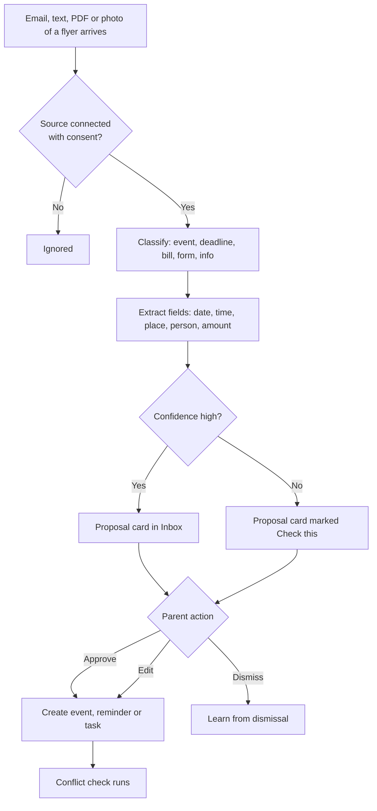

**Business rules**

* Proposals always need approval in Phase 2. Auto approve can be enabled per trusted sender later.
* Only matching emails are processed; Patria never stores unrelated email content.
* Parents can see and revoke every connected source at any time.

**Edge cases**

| Scenario | What Patria does |
|---|---|
| Email covers several children | Assign to the right child using class or team names learned over time. |
| Event cancelled in a later email | Propose cancellation linked to the original event. |

**Acceptance criteria (definition of done)**

* [ ] Proposals require approval; 85% field extraction accuracy on the test set.
* [ ] Unrelated email content is not stored.

**Data captured:** Source references, extracted fields, proposals, decisions.

**Success measure:** Self reported mental load score improves 25% after 90 days for families using intake.

### BRN03 Unified Weekly View

**Priority:** P1 | **Phase:** Phase 2 (calendar import from Phase 1) | **Users:** All members | **Depends on:** Calendar connectors

**What it is.** One simple picture of the family’s week across phone, TV and a kitchen display. It merges Google, Apple and Outlook calendars, school schedules and Patria tasks, colored by person. A read only calendar import ships in Phase 1 to power the Family Sync agenda.

**Why it matters.** Families need one place to see the week, not five apps.

**User stories**

* As a family, we want the week on the kitchen display, so that everyone knows what is happening without asking.

**How it works**

1. Members connect their calendars and choose which ones the family sees (busy only or details).
2. Patria merges events, tasks and reminders into a weekly view per person and for the household.
3. Display mode shows a large, glanceable layout readable from 2 meters.
4. Two way sync lets approved Patria events write back to members’ calendars.

**Business rules**

* Members control whether others see details or only "busy".
* Work calendars default to busy only.
* Display mode hides sensitive events (medical, therapy) unless allowed.

**Edge cases**

| Scenario | What Patria does |
|---|---|
| Member disconnects a calendar | Their events disappear from the family view immediately. |

**Acceptance criteria (definition of done)**

* [ ] Loads in under 2 seconds; readable from 2 meters in display mode.
* [ ] Busy only calendars never reveal event titles.

**Data captured:** Calendar links, merged events, visibility settings.

**Success measure:** 60% of Family plan households open the weekly view 3 or more days a week.

### BRN04 Conflict Spotting

**Priority:** P1 | **Phase:** Phase 2 | **Users:** Parents | **Depends on:** BRN03

**What it is.** Patria flags clashes days ahead ("Dentist and soccer overlap Thursday") and travel impossibilities, and offers options: move, swap driver, ask a carpool family, or skip.

**Why it matters.** Catching conflicts early prevents last minute scrambles.

**User stories**

* As a parent, I want to know on Monday that Thursday has a clash, so that I can arrange a ride in time.

**How it works**

1. Every new or changed event triggers a check against people, places and travel time.
2. Conflicts are shown at least 48 hours ahead with suggested fixes.
3. Choosing a fix updates the events and notifies the affected people.

**Business rules**

* Conflicts consider who must be present (child plus a driver), not just overlapping times.
* Suggestions never change events without approval.

**Edge cases**

| Scenario | What Patria does |
|---|---|
| Event location unknown | Use typical travel time and ask for the address. |

**Acceptance criteria (definition of done)**

* [ ] Overlaps flagged at least 48 hours before.
* [ ] At least one suggested fix offered for every flagged conflict.

**Data captured:** Conflicts, suggestions, resolutions.

**Success measure:** 70% of flagged conflicts resolved before the day.

### BRN05 Tasks with Ownership

**Priority:** P1 | **Phase:** Phase 2 | **Users:** All members | **Depends on:** GOV02

**What it is.** Household tasks with an owner, frequency, backup and standard. Example: Trash; owner Sofia; Tuesday and Friday; backup Dad; done before 7pm. If the owner misses it, the backup is notified.

**Why it matters.** Ownership teaches children that everyone contributes, and backups stop tasks falling through the cracks.

**User stories**

* As a parent, I want each child to own specific chores with a clear standard, so that I stop reminding everyone.
* As a teen, I want to swap a task with my sibling in the app, so that we handle it ourselves.

**How it works**

1. Tasks are created during the Family Sync or anytime, with owner, frequency, backup and standard.
2. Owner gets a reminder at the right time; children see picture cards.
3. Task moves through states as shown; missed tasks are logged for the next Sync, not shamed.
4. Owners can request a swap; the other person accepts.

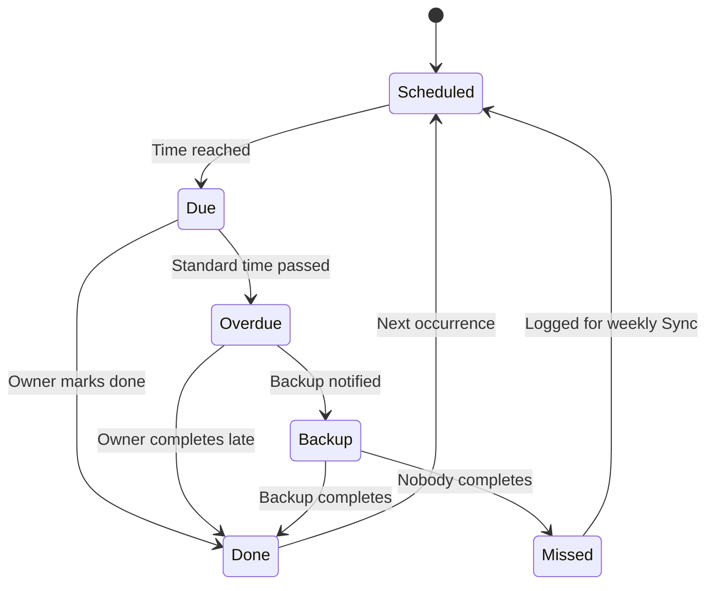

**Business rules**

* Every recurring task must have a backup.
* Children’s tasks can be tied to allowance (CARE08) if parents choose.
* No public leaderboards between siblings.

**Edge cases**

| Scenario | What Patria does |
|---|---|
| Owner is away (calendar shows travel) | Backup becomes owner for those days automatically, with notice. |

**Acceptance criteria (definition of done)**

* [ ] Backup notified automatically if a task is missed.
* [ ] Swap requests require acceptance by the other person.

**Data captured:** Task, owner, backup, frequency, standard, completion history.

**Success measure:** Task completion rate above 75% in active families.

### BRN06 Fair Share

**Priority:** P1 | **Phase:** Phase 2 | **Users:** Adults | **Depends on:** BRN05, BRN02

**What it is.** Patria tracks who usually handles what (school forms, appointments, groceries, pickups, laundry) and shows a monthly load summary for each adult, with gentle suggestions to rebalance.

**Why it matters.** The mental load is invisible until it is measured. Fair Share makes it visible without blame.

**User stories**

* As a mum, I want my husband to see how many school tasks I handled this month, so that we can split them fairly without an argument.

**How it works**

1. Every completed task, approved intake item and handled appointment is attributed to an adult.
2. Monthly summary shows categories and approximate time per adult.
3. Patria suggests specific handovers ("Dad could own dentist appointments").
4. Accepted suggestions change task owners going forward.

**Business rules**

* Summaries are visible only to adults in the household.
* Suggestions never reassign without both adults agreeing.
* Language is neutral; no "winner" or "loser" framing.

**Edge cases**

| Scenario | What Patria does |
|---|---|
| One adult works away for months | Allow a "season" setting so summaries stay fair. |

**Acceptance criteria (definition of done)**

* [ ] Monthly load summary per adult.
* [ ] No reassignment happens without consent from both adults.

**Data captured:** Attributed actions, categories, time estimates, suggestions.

**Success measure:** Gap between adults’ load shares narrows over 6 months in families using Fair Share.

### BRN07 Meals, Groceries and Home Maintenance

**Priority:** P2 | **Phase:** Phase 2 | **Users:** All members | **Depends on:** BRN01, BRN03

**What it is.** Shared grocery lists, meal ideas based on what the family likes and who is home that night, and maintenance reminders (HVAC filters, smoke alarm batteries, car service). Lists can be pushed to local delivery services.

**Why it matters.** Meals and maintenance are the daily grind that eats parents’ time.

**User stories**

* As a parent, I want meal ideas that fit who is home tonight and what the kids eat, so that dinner is not a daily debate.
* As a homeowner, I want a reminder to change the HVAC filter, so that I do not forget for a year.

**How it works**

1. Anyone adds items by voice, text or barcode.
2. Meal suggestions use family preferences and allergies from the knowledge base.
3. Maintenance schedules are created from appliance info and seasons.
4. Lists can be sent to supported delivery partners.

**Business rules**

* Allergy rules always override meal suggestions.
* Delivery partners receive only the list, never other family data.

**Edge cases**

| Scenario | What Patria does |
|---|---|
| Two people add the same item | Merge and show both names. |

**Acceptance criteria (definition of done)**

* [ ] Shared list syncs across members in real time.
* [ ] Meal suggestions never include a listed allergen.

**Data captured:** Lists, preferences, maintenance schedule.

**Success measure:** Weekly list use by 40% of Family plan households.

### BRN08 Handover Guide for Babysitters and Sitters

**Priority:** P2 | **Phase:** Phase 2 | **Users:** Parents (create), caregivers (view) | **Depends on:** BRN01, CIR02

**What it is.** A one tap guide for a babysitter, grandparent or house sitter with only what they need: routines, bedtimes, allergies, emergency contacts, WiFi, and house notes. Shared by a time limited link.

**Why it matters.** Parents rewrite the same notes every time they go out. This makes it instant and safe.

**User stories**

* As a parent, I want to send the babysitter tonight’s guide in one tap, so that we can leave on time.

**How it works**

1. Parent taps Create handover, picks the children, dates and caregiver.
2. Patria assembles the guide from facts tagged Handover and tonight’s schedule.
3. Caregiver opens a secure link; no app required.
4. Link expires automatically at the end time.

**Business rules**

* Maximum link life 30 days; default 24 hours.
* Caregivers can never see memories, documents or the vault.

**Edge cases**

| Scenario | What Patria does |
|---|---|
| Caregiver forwards the link | Link requires a one time code sent to the caregiver’s phone. |

**Acceptance criteria (definition of done)**

* [ ] Time limited link expires automatically.
* [ ] Guide includes emergency card (CARE01) for each child.

**Data captured:** Guide content snapshot, access log.

**Success measure:** Guide created at least once by 30% of families with young children.

## Care, Protection and Money (CARE)

*Pillar 4: Care and Protection.* Care and Protection is one trusted place for the family’s health, safety, money and important documents, including care for aging parents. These features handle the most sensitive data in Patria, so they use the encrypted vault tier, strict circles and careful language. Patria supports care; it never diagnoses.

### CARE01 Emergency Card

**Priority:** P1 | **Phase:** Phase 2 | **Users:** All members, caregivers, first responders | **Depends on:** BRN01

**What it is.** For each person: emergency contacts, blood type, allergies, medications, conditions, doctor and insurance. Reachable in two taps, from a lock screen widget, and printable as a wallet card.

**Why it matters.** In an emergency, seconds matter and the person who knows the details may not be there.

**User stories**

* As a grandparent babysitting, I want Lily’s allergy and doctor details instantly, so that I can act fast if something happens.

**How it works**

1. Admin fills the card for each person (prefilled from the knowledge base).
2. Cards are available offline on every household device.
3. Lock screen widget and printable card offered.
4. Family emergency plan (meeting points, who picks up kids, what to do in fire, storm or power outage) sits alongside.

**Business rules**

* Cards are visible to household and active caregivers only.
* Cards work offline and are cached securely.

**Edge cases**

| Scenario | What Patria does |
|---|---|
| Phone is locked and owner unconscious | Medical ID style widget shows only the essentials chosen by the owner. |

**Acceptance criteria (definition of done)**

* [ ] Reachable in two taps, including from the lock screen widget.
* [ ] Available offline.

**Data captured:** Medical essentials, contacts, plan.

**Success measure:** 70% of Family plan households complete cards for every member.

### CARE02 Health Records

**Priority:** P2 | **Phase:** Phase 3 | **Users:** Parents, adult children for elders | **Depends on:** Vault tier

**What it is.** Per person health records: vaccinations, prescriptions, allergies, insurance cards, visit notes, and children’s growth (height, weight, milestones) with photos linked from the memory stream.

**Why it matters.** Families repeat the same health history at every new doctor and lose track of vaccination records.

**User stories**

* As a parent, I want vaccination records ready for school forms, so that I do not search through old papers.

**How it works**

1. Add records by scan, photo, or import from supported patient portals.
2. Patria extracts key fields and builds a timeline per person.
3. Growth charts plot measurements with milestones and photos.
4. Share a record with a doctor through a time limited link.

**Business rules**

* Health data lives in the encrypted vault tier.
* Teens’ health records follow the agreed teen boundaries (GROW02) and local law on minor consent.

**Edge cases**

| Scenario | What Patria does |
|---|---|
| Imported record conflicts with entered data | Show both and ask which is correct. |

**Acceptance criteria (definition of done)**

* [ ] Documents searchable; encrypted at rest and in transit.
* [ ] Time limited share links expire automatically.

**Data captured:** Records, measurements, documents.

**Success measure:** Used by 20% of Family plan households in Phase 3.

### CARE03 Medication Reminders with Escalation

**Priority:** P2 | **Phase:** Phase 3 | **Users:** Elders, children, adults, care circle | **Depends on:** CARE04

**What it is.** Reminders for medicines for kids, adults and aging parents. If a dose is not confirmed, Patria sends a second reminder and then nudges the care circle member on duty.

**Why it matters.** Missed doses for aging parents are a top worry for adult children living far away.

**User stories**

* As a son in another city, I want to know if Mom missed her morning tablet, so that I can call her.

**How it works**

1. Add medicine, dose, times and who confirms (the person, or a caregiver).
2. Reminder at dose time by app, SMS or voice call.
3. No confirmation within the grace period triggers a second reminder.
4. Still no confirmation: the on duty care member is nudged to check in.

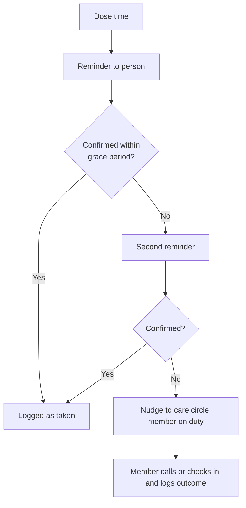

**Business rules**

* Grace period default 30 minutes, configurable.
* Elders can confirm by replying 1 to an SMS or pressing 1 on a call.
* Patria does not give medical advice about doses.

**Edge cases**

| Scenario | What Patria does |
|---|---|
| Elder is traveling across time zones | Ask whether to follow home or local time. |

**Acceptance criteria (definition of done)**

* [ ] Escalation after a configurable delay.
* [ ] Confirmation possible without an app.

**Data captured:** Medicine schedule, confirmations, escalations.

**Success measure:** Missed dose rate falls over first 60 days.

### CARE04 Elder Care Hub

**Priority:** P2 | **Phase:** Phase 3 | **Users:** Adult siblings, caregivers | **Depends on:** CIR01 custom circles

**What it is.** A shared space for adult siblings and carers to coordinate care of a parent: updates from doctor visits, a care timeline, split tasks, who is on duty this week, and shared notes and documents.

**Why it matters.** The sandwich generation struggles with coordination and unequal effort among siblings.

**User stories**

* As David, I want my sister and I to see the same updates after Mom’s appointments, so that we stay on the same page.

**How it works**

1. Create a care circle for the parent with siblings and carers.
2. Post updates after visits; voice notes are summarized.
3. Assign care tasks and a weekly on duty rota.
4. All members see one timeline.

**Business rules**

* The parent being cared for can see the hub if they choose and are able.
* Paid carers have time limited, scoped access.

**Edge cases**

| Scenario | What Patria does |
|---|---|
| Siblings disagree on care decisions | Offer the Decision Framework (GOV04) within the care circle. |

**Acceptance criteria (definition of done)**

* [ ] All care team members see the same timeline.
* [ ] On duty rota drives escalation targets for CARE03 and CARE05.

**Data captured:** Care timeline, tasks, rota, documents.

**Success measure:** Weekly use by 50% of care circles.

### CARE05 Early Signals

**Priority:** P2 | **Phase:** Phase 3 | **Users:** Care circle | **Depends on:** CARE04, consent of the person

**What it is.** Patria learns routines (a usual Sunday call, a morning check in, regular app or SMS activity) and gently prompts someone to check in when a routine breaks in a worrying way.

**Why it matters.** Small changes are often the first sign something is wrong, especially for elders living alone.

**User stories**

* As a daughter, I want a nudge when Dad has not replied to anything for two days, so that I can call him.

**How it works**

1. With consent from the person, Patria learns routines over about 4 weeks.
2. Each day it compares activity to the routine.
3. Known reasons (travel, holidays, calendar events) are excluded.
4. Unexplained breaks prompt one care member with a one tap call or message.

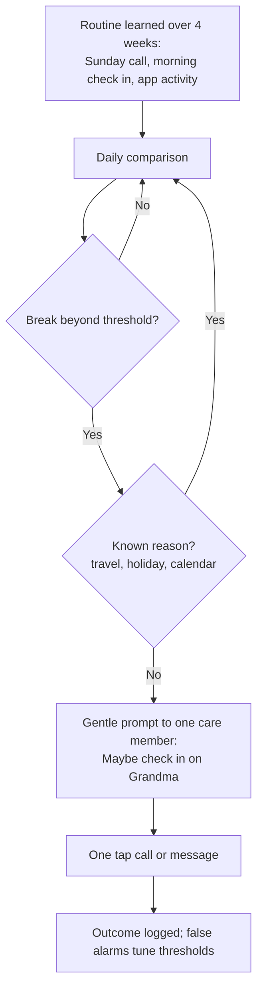

**Business rules**

* Signals require the monitored person’s consent and can be paused by them.
* Wording is always a suggestion to check in, never a diagnosis.
* False alarms adjust thresholds automatically.

**Edge cases**

| Scenario | What Patria does |
|---|---|
| Phone broken | Signals stay quiet until a second channel also goes silent. |

**Acceptance criteria (definition of done)**

* [ ] Signals are suggestions to check in, never diagnoses.
* [ ] Monitored person can see and pause monitoring.

**Data captured:** Routine model, signals, outcomes.

**Success measure:** False alarm rate below 1 per month per elder.

### CARE06 Scam Protection

**Priority:** P2 | **Phase:** Phase 3 | **Users:** Elders, trusted family members | **Depends on:** CIR03

**What it is.** Patria warns older relatives about suspicious calls and messages (urgent payment requests, "grandchild in trouble", fake bank alerts) and loops in a trusted family member with one tap.

**Why it matters.** Elders are frequent targets of scams, and families often find out too late.

**User stories**

* As Grandpa, I want to forward a strange text to Patria and be told if it is safe, so that I do not lose money.

**How it works**

1. Elder forwards a message or Patria detects one sent to its number.
2. Patria checks for urgency, payment requests, unknown numbers and known scam patterns.
3. Elder receives a plain warning: "This looks like a scam. Do not pay yet."
4. Trusted family member gets an "Ask family" alert to call and confirm.

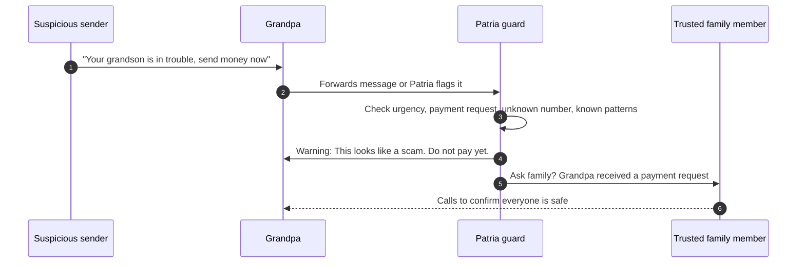

**Business rules**

* Patria never reads elders’ messages unless forwarded or sent to Patria.
* Warnings use calm, simple language.

**Edge cases**

| Scenario | What Patria does |
|---|---|
| Real emergency message from a grandchild | Family member call confirms; no harm in pausing. |

**Acceptance criteria (definition of done)**

* [ ] Suspicious message flagged with a one tap "Ask family" action.

**Data captured:** Forwarded messages, risk scores, alerts.

**Success measure:** Reported prevented losses; elder trust score in surveys.

### CARE07 Document Vault and Renewals

**Priority:** P1 | **Phase:** Phase 3 | **Users:** Parents, successors | **Depends on:** Vault tier, GROW04

**What it is.** Secure storage for wills, deeds, birth certificates, passports, insurance policies and car documents, with renewal reminders (passports, insurance, registration, subscriptions) and access rules for now and for later.

**Why it matters.** When something happens, families scramble to find documents. The vault is also central to the digital estate.

**User stories**

* As a parent, I want a reminder 6 months before passports expire, so that holiday plans are not ruined.
* As a parent, I want our will to be accessible to my sister only if something happens to us both.

**How it works**

1. Upload or scan documents; Patria detects type and expiry dates.
2. Renewal reminders are set automatically.
3. Access rules: who can see now, and who gets access on a custody trigger.
4. Digital estate notes: instructions for photos, accounts and devices.

**Business rules**

* Vault content is zero knowledge encrypted.
* Future access rules run through the custody protocol (GROW04).

**Edge cases**

| Scenario | What Patria does |
|---|---|
| Document in a foreign language | Detect expiry dates in common formats; ask if unsure. |

**Acceptance criteria (definition of done)**

* [ ] Vault content is zero knowledge encrypted.
* [ ] Expiry reminders at 6 months, 1 month and 1 week by default.

**Data captured:** Documents (encrypted), type, expiry, access rules.

**Success measure:** Average of 10 or more documents per Legacy plan family.

### CARE08 Shared Goals and Kids Money

**Priority:** P2 | **Phase:** Phase 3 | **Users:** Parents, children, extended family | **Depends on:** BRN05

**What it is.** Shared savings goals (vacation fund, college, a gift for Grandpa’s 80th) with visible progress, plus allowance tied to chores and simple savings goals that teach children the basics.

**Why it matters.** Money conversations are easier when goals are shared and children learn by doing.

**User stories**

* As a 10 year old, I want to see how close I am to buying my bike, so that I keep saving.
* As cousins, we want to contribute to Grandpa’s 80th birthday gift, so that it is a family surprise.

**How it works**

1. Create a goal with target and circle.
2. Track contributions manually or through a supported banking partner.
3. Allowance rules link chores (BRN05) to amounts.
4. Children see a simple progress jar.

**Business rules**

* Patria does not hold money in Phase 3; it tracks only.
* Finances at a glance view is optional and adults only.

**Edge cases**

| Scenario | What Patria does |
|---|---|
| Contribution recorded twice | Detect duplicates by amount and date; ask to confirm. |

**Acceptance criteria (definition of done)**

* [ ] Progress visible to the chosen circle.
* [ ] Allowance calculated from completed tasks.

**Data captured:** Goals, contributions, allowance rules.

**Success measure:** 20% of families with children 8 to 12 use allowance.

## Growing Up and Custody (GROW)

*Pillar 5: Growing Up.* Patria changes with the family. Growing Up features move responsibility, then ownership, from parents to children, and make sure the family’s space and legacy pass safely to the next generation. This is the "capability, not control" principle in software, and it holds two of Patria’s strongest patent candidates.

### GROW01 Age Bands

**Priority:** P1 | **Phase:** Phase 3 | **Users:** Children, teens, parents | **Depends on:** CIR02

**What it is.** Tailored experiences for four stages, each with its own home screen, language and permissions: 4 to 7 (How does our family work?), 8 to 12 (How do I contribute?), 13 to 17 (How do I become an adult?), and 18+ (How do I operate independently?).

**Why it matters.** A five year old and a fifteen year old need very different tools, and both should grow into more responsibility.

**User stories**

* As a 6 year old, I want picture routines and a feelings button, so that I can use Patria myself.
* As a 14 year old, I want budgeting and planning tools, so that I practice being independent.

**How it works**

1. Age band is set from date of birth and confirmed by a parent.
2. Each band unlocks features suited to it (see figure).
3. On a birthday that crosses a band, Patria prepares a "level up" moment with the new features explained.
4. Parents can hold a child in a band longer if needed.

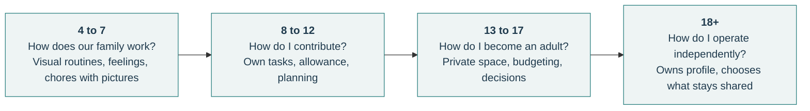

**Business rules**

* Children under 13 never see open messaging with people outside the household.
* No streaks, points pressure or manipulative engagement for any child band.

**Edge cases**

| Scenario | What Patria does |
|---|---|
| Child with additional needs | Parents can choose any band’s experience regardless of age. |

**Acceptance criteria (definition of done)**

* [ ] Each band has its own home screen and permissions.
* [ ] Band changes are celebrated and explained to the child.

**Data captured:** Band, date of birth, overrides.

**Success measure:** Children 8 to 12 active weekly in 40% of families with that age group.

### GROW02 Teen Private Space and Agreements

**Priority:** P1 | **Phase:** Phase 3 | **Users:** Teens, parents | **Depends on:** GROW01

**What it is.** Teens get their own private space (journal, photos, plans) and a written agreement with parents about what parents can see: location rules, screen time, curfew, and privacy. Both sides see the current agreement; changes need both.

**Why it matters.** Trust grows when boundaries are agreed rather than imposed. It also keeps teens using Patria instead of avoiding it.

**User stories**

* As a teen, I want my journal fully private, so that I can be honest with myself.
* As a parent, I want an agreed rule that location sharing turns on when Sofia is out after 10pm, so that I worry less.

**How it works**

1. When a child turns 13, Patria invites parents and teen to set an agreement.
2. Templates suggest common areas; each side proposes terms.
3. Both accept; the agreement is visible to both and reviewed every 6 months.
4. Any change requires both to accept.

**Business rules**

* Private space content is encrypted with the teen’s own key.
* Safety exception: if a teen shares content about self harm or danger, Patria shows support resources to the teen and encourages reaching out. It does not secretly alert parents unless the agreement or law requires it.

**Edge cases**

| Scenario | What Patria does |
|---|---|
| Parent wants to override the agreement | Override is possible only by visible action that the teen is told about. |

**Acceptance criteria (definition of done)**

* [ ] Both sides can see the current agreement; changes require both.
* [ ] Parents cannot read teen private space by default.

**Data captured:** Agreement terms, versions, acceptances.

**Success measure:** Teen weekly activity above 50% in families with teens.

### GROW03 Capability Transfer

**Priority:** P2 | **Phase:** Phase 3 | **Users:** Children growing into adults, parents | **Depends on:** GROW01, GROW02

**What it is.** Responsibilities and data ownership move gradually from parent to child. Children take over tasks (booking their own appointments, managing their own money goals) as they show competence. At 18, the young adult owns their profile, memories and data and chooses what stays shared with the family.

**Why it matters.** The goal of parenting is an adult who can run their own life. Patria builds that path in.

**User stories**

* As an 18 year old, I want to take my childhood photos and drawings with me, so that my history is mine.
* As a parent, I want my 16 year old to manage their own dentist appointments, so that they learn.

**How it works**

1. Each age band has a list of "handover ready" responsibilities.
2. Parent and child agree a handover; the task owner changes to the child with the parent as backup.
3. At 18, Patria walks the young adult through ownership: profile, memories, health records, and what to share with the family.
4. The young adult can start their own family space later, linked to their parents’ tree.

**Business rules**

* Ownership transfer at 18 is automatic unless the young adult or a legal guardian arrangement says otherwise.
* Shared family items stay shared; the young adult gets their own copy.

**Edge cases**

| Scenario | What Patria does |
|---|---|
| Young adult chooses to leave the family space | They keep their copies; family keeps shared copies. |

**Acceptance criteria (definition of done)**

* [ ] At 18, the young adult owns their profile and chooses what stays shared.
* [ ] Each band lists handover ready responsibilities.

**Data captured:** Responsibility handovers, ownership state.

**Success measure:** 70% of young adults stay connected to the family space after 18.

### GROW04 Generational Custody Handover

**Priority:** P2 | **Phase:** Phase 3 | **Users:** Parents (owners), successors, trusted third party | **Depends on:** Vault tier, LEG02, CARE07

**What it is.** A secure protocol that passes ownership of the family space and its encryption keys to named successors on a trigger: a verified death or incapacity of the owners, or an agreed age milestone. The recovery key is split into shares so that no single person, and not Patria, can unlock the vault alone.

**Why it matters.** A legacy that can be locked out is no legacy. This makes Patria the first family platform designed to outlive its founders.

**User stories**

* As a father, I want my children to inherit our family space and my letters even if both my wife and I die suddenly, so that nothing is lost.
* As a successor, I want a clear, dignified process, so that I can take over during a hard time.

**How it works**

1. Owners name successors, a trusted third party (for example an estate lawyer or escrow partner), and trigger rules.
2. The family recovery key is split into three shares; any two can unlock.
3. Shares are stored on successors’ devices and with the third party.
4. On a trigger, a successor starts the handover with evidence (death certificate or legal document).
5. A waiting period lets the owners cancel if they are able.
6. A second share holder confirms; shares combine and ownership moves.
7. Scheduled letters and release rules continue under the new owners.

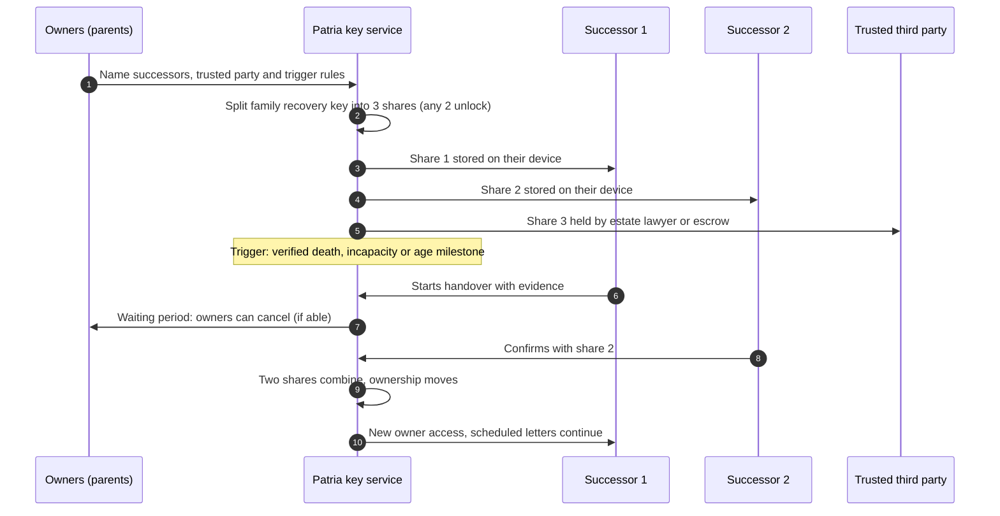

**Business rules**

* Waiting period default 14 days, minimum 7.
* No Patria employee can trigger or complete a handover.
* Every step is logged in a tamper evident audit trail.
* Owners are reminded yearly to review successors.

**Edge cases**

| Scenario | What Patria does |
|---|---|
| A successor has died or lost their device | Owners are prompted to reissue shares; third party share keeps recovery possible. |
| Disputed handover between successors | Process pauses; third party and the family resolve; Patria does not decide. |

**Acceptance criteria (definition of done)**

* [ ] Tested recovery drill completes with any two of three shares.
* [ ] No single company employee can trigger a handover.
* [ ] Audit trail shows every step with timestamps.

**Data captured:** Successors, share metadata, triggers, audit trail.

**Success measure:** 50% of Legacy plan families complete custody setup.

### GROW05 Life Transition Kits

**Priority:** P2 | **Phase:** Phase 3 | **Users:** Parents, adult children | **Depends on:** BRN05, CIR01

**What it is.** Ready made kits for big moments: new baby, starting school, teen years, leaving home, moving house, divorce and two home parenting, illness and loss. Each kit creates the right checklist, circle and memory collection.

**Why it matters.** Transitions are when families feel most overwhelmed and most need structure.

**User stories**

* As new parents, we want feeding and sleep notes plus an easy way to share updates with grandparents, so that we are not answering 20 messages a day.
* As a family moving house, we want an address change checklist and an "our old home" memory collection.

**How it works**

1. Family picks a kit or Patria suggests one from detected events.
2. Kit creates tasks, a circle if needed, and a memory collection.
3. Kit closes with a short reflection saved to family history.

**Business rules**

* Sensitive kits (divorce, illness, loss) never appear as suggestions without a member starting them.

**Edge cases**

| Scenario | What Patria does |
|---|---|
| Divorce kit in a linked household setup | Uses CIR04 sharing rules between homes. |

**Acceptance criteria (definition of done)**

* [ ] Each kit creates the relevant checklist, circle and memory collection.

**Data captured:** Kit instances, tasks, collections.

**Success measure:** Kit completion rate above 50%.

## Family AI (AI)

*Connective layer.* The Family AI understands the family’s context and ties every pillar together. It answers from the family’s own records, plans, drafts and gently observes. It follows three rules everywhere: it only uses what the asker is allowed to see, it shows its sources, and it never acts without approval.

### AI01 Memory Answers

**Priority:** P0 | **Phase:** Phase 1 | **Users:** All members | **Depends on:** MEM01, CIR01

**What it is.** Ask questions about the family’s life in plain language: "When did we last visit San Antonio?", "What did Mom cook at Christmas 2019?", "Show me Grandpa’s farm". Every answer cites the photos, events or notes it came from.

**Why it matters.** It turns years of scattered context into instant answers and is the first taste of the Family AI.

**User stories**

* As a child, I want to ask "What was I like when I was a baby?" and see photos and stories, so that I learn my own history.

**How it works**

1. Member asks by text or voice.
2. Patria identifies the asker’s role and circles.
3. Retrieval pulls only items this person may see.
4. A model isolated to this family composes the answer with source cards.
5. If the question implies an action, a draft is shown for approval.

```mermaid
flowchart TD
  A[Member asks: When did we last visit San Antonio?] --> B[Identify asker role and circles]
  B --> C[Retrieve only items this person may see]
  C --> D[Compose answer with model<br/>isolated to this family]
  D --> E[Attach source cards: photos, events, notes]
  E --> F{Action requested?}
  F -- No --> G[Show answer]
  F -- Yes --> H[Show draft action for approval<br/>never acts alone]
```

**Business rules**

* No answer without at least one source, or a clear "I could not find that".
* Family data is never used to train shared models without explicit opt in.
* Each family’s data is isolated in retrieval and processing.

**Edge cases**

| Scenario | What Patria does |
|---|---|
| Question about an item in a circle the asker cannot see | Answer as if it does not exist; no hints. |
| Ambiguous name ("Dad") | Resolve from the asker’s relationship; ask if unsure. |

**Acceptance criteria (definition of done)**

* [ ] Every answer cites its source item.
* [ ] Red team tests confirm no cross circle or cross family leakage.

**Data captured:** Queries, answers, source references (logs kept 30 days, then deleted).

**Success measure:** Answer helpfulness above 80% thumbs up.

### AI02 Plans That Fit

**Priority:** P1 | **Phase:** Phase 2 | **Users:** Parents, teens | **Depends on:** BRN03, BRN01

**What it is.** Suggest weekend outings, trips or family time that fit everyone’s schedules, energy, preferences and budget.

**Why it matters.** Planning family time is another hidden job; Patria makes it easy to say yes.

**User stories**

* As a parent, I want a Saturday plan that works for a toddler and a teen and costs under $50, so that we actually go out.

**How it works**

1. Member asks or Patria notices free time for everyone.
2. Plan respects calendars, preferences and budget.
3. Member edits and adds to the calendar.

**Business rules**

* Plans never book or pay for anything without approval.

**Edge cases**

| Scenario | What Patria does |
|---|---|
| Weather changes | Offer an indoor alternative. |

**Acceptance criteria (definition of done)**

* [ ] Plans respect calendar conflicts.
* [ ] Budget limits are always honored.

**Data captured:** Plan drafts.

**Success measure:** One in five plans added to the calendar.

### AI03 Creative Help

**Priority:** P1 | **Phase:** Phase 2 | **Users:** All members | **Depends on:** AI01

**What it is.** Drafts toasts, thank you notes, birthday messages and letters using family stories, such as Grandpa’s birthday toast from old stories or a thank you note in the kids’ words.

**Why it matters.** It helps people say meaningful things using the family’s real history.

**User stories**

* As a grandson, I want a toast for Grandpa’s 80th that mentions his farm and his jokes, so that it feels personal.

**How it works**

1. Member asks for a draft and picks the tone.
2. Patria pulls relevant stories the member can see.
3. Draft is shown for editing; nothing is sent automatically.

**Business rules**

* Drafts are never sent automatically.
* Content from Only Me items is never used in drafts for others.

**Edge cases**

| Scenario | What Patria does |
|---|---|
| Draft mentions a sensitive memory | Flag it for the author to confirm. |

**Acceptance criteria (definition of done)**

* [ ] Draft is editable and never sent automatically.

**Data captured:** Drafts (not stored after 30 days unless saved).

**Success measure:** Saved or used drafts above 40%.

### AI04 Gentle Observations and Nudges

**Priority:** P1 | **Phase:** Phase 2 | **Users:** Adults | **Depends on:** BRN03, CIR03

**What it is.** Thoughtful suggestions such as "You have not called Dad in two weeks", "Both kids are free Saturday afternoon", or "Your son has had three late nights this week, maybe a quiet dinner tonight". Suggestions, never tasks.

**Why it matters.** Small nudges help families stay connected without effort.

**User stories**

* As a busy dad, I want a nudge when it has been a while since I called my mother, so that I stay close.

**How it works**

1. Patria looks for patterns across calendar, contact and activity.
2. A nudge is offered at a sensible time.
3. Member can act, snooze or turn off that type.

**Business rules**

* Quiet by default: maximum 3 nudges a week per person.
* Members choose nudge types.
* Observations about a person are never shown to that person’s siblings.

**Edge cases**

| Scenario | What Patria does |
|---|---|
| Member grieving | Pause nudges about the deceased. |

**Acceptance criteria (definition of done)**

* [ ] User controls nudge types and frequency; quiet by default.

**Data captured:** Nudges, responses.

**Success measure:** Acted on rate above 30%; mute rate below 10%.

### AI05 Voice and Language for Everyone

**Priority:** P1 | **Phase:** Phase 2 | **Users:** All members | **Depends on:** AI01, CIR03

**What it is.** Kids, parents and grandparents can all talk to Patria by text or voice in the languages the family speaks. English at launch; Yoruba, Igbo, Hausa, Spanish and French prioritized next.

**Why it matters.** Diaspora families mix languages; elders often prefer their first language.

**User stories**

* As Grandma, I want to ask Patria in Yoruba how the children are doing, so that I can join in my own language.

**How it works**

1. Detect language automatically.
2. Answer in the same language.
3. Translations shown alongside originals in shared spaces.

**Business rules**

* Original language content is always kept alongside translations.

**Edge cases**

| Scenario | What Patria does |
|---|---|
| Mixed language message | Translate each part and keep the original. |

**Acceptance criteria (definition of done)**

* [ ] English at launch; five more languages by end of Phase 2.

**Data captured:** Language preferences.

**Success measure:** Share of non English interactions among diaspora families.
